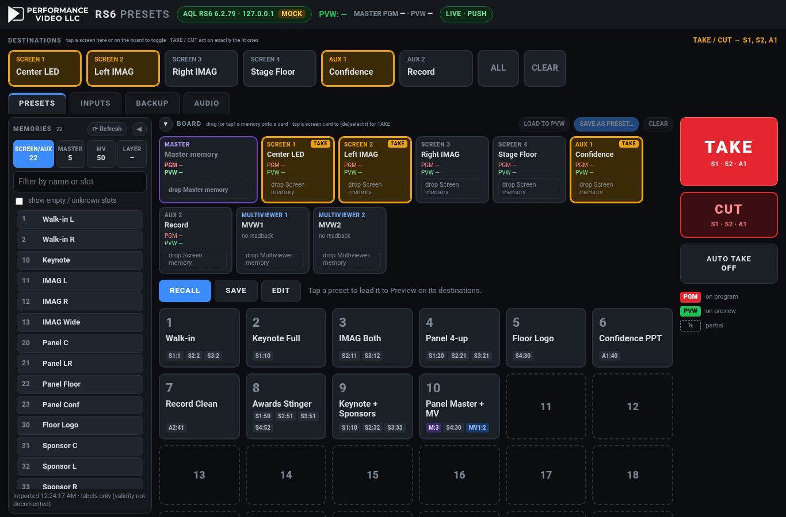
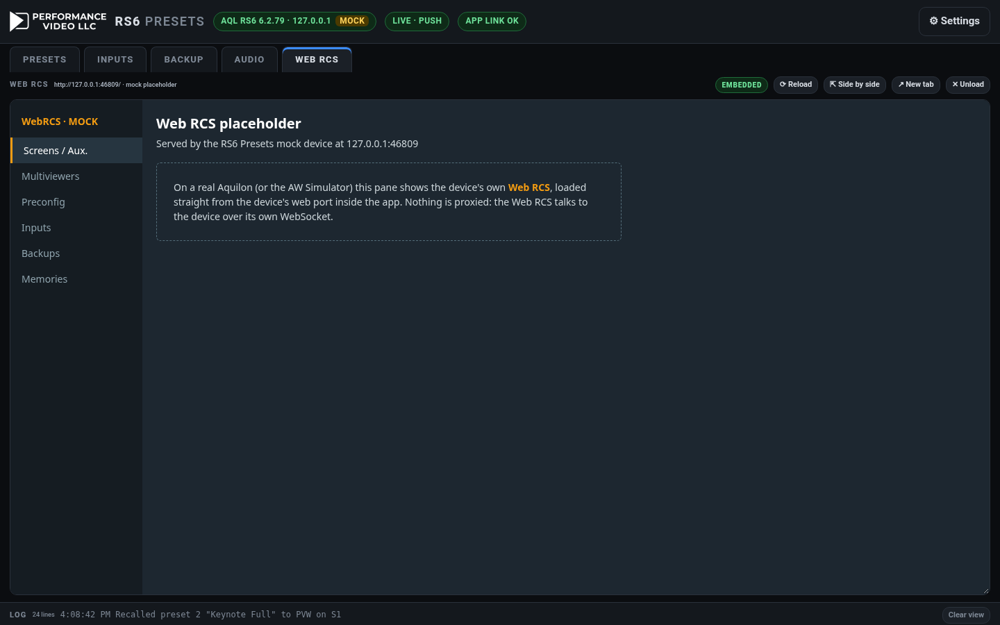

# RS6 Presets


Barco E2-style preset save and recall for an **Analog Way Aquilon RS6** (firmware 6.2.x), in a
browser. It runs on your Mac and serves a dark, touch-friendly UI that an iPad or phone on the same
network can open.

- **Destinations are toggles.** A preset stores only the destinations that were lit when you saved it.
- **Recall loads to Preview on those destinations only**, and the app's destination selection
  changes to match. What's selected on the RC400T doesn't matter, because every load names its
  screen explicitly.
- **TAKE and CUT act only on the lit destinations.** After a recall, those are the preset's destinations.
- **Numbered and named grid with tally.** Green **PVW** marks the preset on Preview, red **PGM** marks
  the preset on Program, and a dashed tag means only some of the preset's destinations match. The last
  recalled preset is shown in the header and outlined in the grid.
- **Update / Overwrite / Rename / Renumber / Duplicate / Delete**, plus an **Auto take on recall** toggle.
- **Live device state (v0.2.0).** A persistent AWJ connection with subscriptions keeps the app in
  step with the RS6, including changes made on the RC400T or the Web RCS:
  - **real input tally** (which inputs are on Program and Preview layers)
  - **last Screen memory** per destination and **last Master memory** with their names
  - **input status** (label, enabled, signal, capability, scope, freeze)
  - **input, background-set and group backups**
  - **per-channel audio mutes**

  There are tabs for **Inputs** (freeze toggle), **Backup** and **Audio**. Preset tally now follows
  the device, not just the app.
- **Memory import and mix-and-match board (v0.3.0).** The app reads the RS6's own memories
  (Screen/Aux, Master, Multiviewer) with slot, name and status, keeps them current through the AWJ
  subscription, and shows them in a **palette grouped by type**. Drag (or tap) a memory onto a
  **screen, aux or multiviewer card** to stage a look, or onto a **preset tile** to build it. Presets can
  now be **combined**: a different memory per screen, plus an optional Master memory and multiviewer
  memories. Recall loads each memory only to its own target. See
  [Memory import and the board](#memory-import-and-the-board-v030).
- **v0.4.0:** **move/swap** preset tiles (drag, or MOVE mode on an iPad), clearer **SAVE PVW → TILE**,
  backups that show only what exists on the device with **group names**, clean INPUTS/BACKUP/AUDIO
  tabs, and the device's **Web RCS in a tab**. Layer memories were removed. See [v0.4.0](#v040-cleaner-tabs-moveswap-presets-clearer-save-real-backup-state-web-rcs-pane).
- **v0.5.0:** **your setup survives updates**: presets and settings live in a per-user data folder,
  not in the app folder, and the first start of a new version copies them from the old copy. **Show files**
  (Save / Save as / Open, a library with backups, autosave), **24/48/72/96 tiles** with a pager, the fix for
  **tiles re-ordering after switching tabs**, and `GET /api/version` for Companion. See [v0.5.0](#v050-persistence-show-files-more-tiles-reorder-fix).
- A **settings page**, a **log panel**, a **mock device mode** and an **HTTP API** for Bitfocus
  Companion (a module ships separately in `companion-module-rs6-presets`). Companion is not how PTZ
  decks run in 0.20. See [Stream Deck (Path C)](#video-control-020-stream-deck-path-c) and
  [Lightning and TSL](#video-control-020-lightning-and-tsl).

No dependencies, no build step for the app. You need Node.js 16 or later (tested on 16 and 20).
The Stream Deck plugin is a separate package and needs Node.js 24.

---

## Video Control 0.20: Stream Deck Path C

Path C is the show deck for Panasonic AW-UE150 cameras. An official Elgato plugin
(`com.performancevideo.control`) calls this app over HTTP. This app calls the camera. The Stream Deck
never opens a camera connection, and Companion is not in that path. The Companion page generator from
0.9.0 is still there for other surfaces. It is not the PTZ deck.

Lightning (NDI ingest into the scopes) and TSL tallies are the other half of 0.20. They are separate
from this plugin. See [Lightning and TSL](#video-control-020-lightning-and-tsl).

### Where it lives

| | |
|---|---|
| Plugin | `streamdeck/` |
| UUID | `com.performancevideo.control` |
| Bundle | `streamdeck/com.performancevideo.control.sdPlugin` |
| Version | 0.20.0 (manifest `0.20.0.0`) |

### Build and load

Stream Deck 7.1 or newer runs the plugin on Node.js 24. Building it uses the same `@elgato/cli` layout
as `streamdeck create` (rollup, `src/plugin.ts`, `manifest.json`).

```bash
cd streamdeck
npm install
npm run build
npx @elgato/cli link com.performancevideo.control.sdPlugin
```

`npm run watch` rebuilds and restarts the plugin while Stream Deck is running. If the category
Performance Video Control does not appear, quit Stream Deck and open it again (a fresh install sometimes
starts the app elevated, and a restart clears that).

`npx @elgato/cli pack com.performancevideo.control.sdPlugin` writes a `.streamDeckPlugin` installer
you can double-click. That file is not a GitHub Release. Releases are cut separately, after this lands.

In each action's property inspector set the Control Center host and port. The default is
`127.0.0.1` port `8080`, which is this app's default. There is no camera address and no password on
the deck.

### Architecture

```
Stream Deck  →  HTTP  →  Control Center  →  Panasonic AW-UE150
                GET /api/deck/ptz          the camera CGI stays here
                POST /api/sys/ptz/cmd/…
```

The plugin long-polls `GET /api/deck/ptz?since=<rev>`. One snapshot has the cameras (name, selected,
red tally), presets 1–18, paint readouts in the same labels as the paint pane, the live recall guard
and the session speeds. A dial sends `POST /api/sys/ptz/cmd/step` with a step count (1 in FINE, 5 in
COARSE). The app reads the current value and adds the step, so two decks cannot race a stale number.
Paint that is locked still returns HTTP 423.

### + XL

The strip is the circular paint knobs (the same 270° arc as the app, gap at the bottom). Keys are
toggles, cycles, recalls and hold-to-run moves. **R gain, B gain, R pedestal and B pedestal are not
keys.** They share two encoders. Push cycles **R · FINE → R · COARSE → B · FINE → B · COARSE**. A tap
on the gain knob runs AWB. A tap on the pedestal knob runs ABB.

HOME, at column 0 row 0 on every page, is the **M4 Viewport** mark. Pressing it opens Control Center.
It does not recall a shot and it does not move a camera.

Red **#C42020** is PGM / LIVE only: a camera key fills red when that camera's red tally is on, and a
preset key takes a red outline and the caption HOLD while the selected camera is live. A feature that
is on uses accent **#3B8CFF**. The idle chip is **#222226** on **#101012**.

| Page | Keys | Dials (columns 0, 2, 3, 5, 6, 8) |
|---|---|---|
| LIVE | Cameras, presets 1–18, IRIS AUTO, PUSH AF, AWB, LIVE GUARD, ALL STOP | IRIS, M.PED, R/B GAIN, R/B PED, ZOOM, FOCUS |
| PAINT | Exposure and white-balance toggles (no R/B −/+) | R/B GAIN, R/B PED, M.DTL, GAMMA, CHROMA, K.POINT |
| FUNC | Tally, power, AF, O.I.S., bars, D.EXT, DRS, night, guard, … | ZOOM, FOCUS, IRIS, M.PED, GAIN, SHUTTER |
| MOVE | 8-way pan/tilt, TELE/WIDE, FAR/NEAR, camera HOME | ZOOM, FOCUS, IRIS, M.PED, PT SPD, ZF SPD |

Page tabs switch Stream Deck profiles named `PTZ Live`, `PTZ Paint`, `PTZ Functions` and `PTZ Move`
when those profiles are installed. `GET /api/deck/ptz/layout` is the same grid, for placing the actions.
ALL STOP is the bottom-right key on every page. On a live camera, preset recall stays in **hold**
(600 ms) unless the guard key cycles it.

---

## Video Control 0.20: Lightning and TSL

These two setups ship in the same 0.20.0 app as Path C. They are not one feature, and neither is the
Stream Deck plugin.

**Lightning** is the engineering scopes tab. The operator picks an NDI source and waveform, RGB parade,
vectorscope and false colour run on that feed. The app does not open NDI. A Mac sidecar receives it and
pushes H.264 into the same relay the camera RTSP path already uses. The Pi does not receive NDI.
`node server.js --mock` adds `ndi:mock-bars` and `ndi:mock-ramps` so a desk with no hardware can select
a source. See [docs/ndi-ingest.md](docs/ndi-ingest.md).

**TSL** is **⌂ SYSTEMS → TALLIES**. Control Center sends TSL 5.0 (mock, or UDP to loopback) from the show
map: PGM red, PVW green. See [docs/tsl-tally.md](docs/tsl-tally.md).

```
node server.js --mock
# Lightning: open the LIGHTNING tab and pick NDI · MOCK BARS
node tools/ndi-sidecar.js --mock --app http://127.0.0.1:8080
```

On a Mac, `node tools/ndi-sidecar.js --ndi "SOURCE NAME" --app http://127.0.0.1:8080` receives one NDI
source (ffmpeg with `libndi_newtek`, or `RS6_NDI_RECV`). `--ndi` does not run on Linux or on a Pi.

---

## How it works (and why)

I read the *AWJ Protocol Programmer's Guide v6.2*, the *REST API Programmer's Guide* (the "v6.0"
file, internally v4.01) and the *User Manual v6.2* to decide between the two approaches in the brief:

| Option | What the docs allow | Verdict |
|---|---|---|
| **(a) Snapshot the whole layer state and write it back** | The only documented reads are layer **source** (REST p.15, AWJ p.11), layer **status** (REST p.15), and **background set** (REST p.17, AWJ p.14). **Position, size, opacity, crop, borders, keying parameters and transitions have no documented read or write.** | Can't reproduce a look. Sources only. |
| **(b) Native Master memories filtered to the chosen screens** | Master memories can be **loaded** (REST p.13, AWJ p.10). **Neither guide documents a save**, for Master or Screen memories. Filtered Master saves exist only in the Web RCS UI (Manual §15.2.1). | Can't be created from the API. |

So the app uses a **hybrid**, as the brief suggested for this case:

1. **Primary: per-destination Screen memories.** Each app preset stores
   `{ destination → Screen memory slot }`, for example `{ S1: 20, S2: 21, A1: 40 }`. Recall sends one
   explicit, documented load per destination: REST `POST /screens/{id}/load-memory` or
   `/auxiliary-screens/{id}/load-memory` with `target: "preview"`. The device's own memory restores
   the full look (positions, sizes, keys and so on), and only the named screens change.
2. **Slot detection when you save.** If AWJ is reachable, the app reads each destination's TBAR side
   (AWJ p.13) and then the **last Screen memory loaded to its Preview** (AWJ p.16), and pre-fills the
   slot. You can always type or correct slots yourself, in the Save dialog or later in EDIT.
3. **Fallback: source snapshot (a reduced form of approach a).** When you save, the app also reads
   each destination's Preview layer sources and background set over REST. If a destination has no
   memory slot, recall writes those sources back (REST p.16, p.18, p.24–25). Only *which source is in
   which layer* is restored, not geometry.

Why this is the more robust option: it uses only documented calls; the look stays in the switcher's
own memory, so the Web RCS, the RC400T and this app all agree on what "memory 20" is; and recall
never depends on what is selected on the controller.

**What you do differently from E2:** the app can't create Aquilon memories, so you build the look on
Preview and save it as a Screen memory in the Web RCS (Memories tab › Screen › Save; Manual §15.3.1).
A Master memory save with "create Screen memories" also works (§15.2.1). Then save the app preset over
those destinations. If the app has seen the memory loaded on Preview, the slot fills in automatically.

---

## Live device state (v0.2.0)

When **Live device state** is on (Settings; the default), the app keeps one AWJ TCP connection open
to port 10606 alongside the REST commands:

1. **Discover:**
   - per-destination layer count: layer capability, §3.5 p.10
   - which inputs have labels: §6.1 p.24
   - which audio channels and backup groups answer: §5.1–5.2, §6.10
2. **Read everything once.** Gets are pipelined, and replies are matched by path.
3. **Subscribe** (§1.4 p.4–5) with one `replace` on `Subscriptions` listing path prefixes:
   - per destination:
     - `DeviceObject/$screenAuxGroup/@items/{S1}/status/@props/transition` (TBAR side, §3.8)
     - `DeviceObject/{$screen|$auxiliary}/@items/{S1}/control/@props/label`
     - each `…/$preset/@items/{A|B}/$layer/@items/{n|NATIVE}/source` (§3.6, §3.8–3.10)
   - `DeviceObject/presetBank/status/presetId` (last Screen memory, §3.11)
   - `DeviceObject/masterPresetBank/status/lastUsed` (last Master, §3.12)
   - `DeviceObject/presetBank/$bank` and `DeviceObject/masterPresetBank/$bank` (memory labels, §3.7)
   - `DeviceObject/$input/@items/` (inputs and input backups, §6.1, §6.4–6.6)
   - `DeviceObject/backup/$group` (§6.10–6.11)
   - `DeviceObject/preconfig/backgrounds/$screen/@items/{S}/$backgroundSet` (§6.7–6.9)
   - each `DeviceObject/audio/control/$device/@items/1/$rx|$tx/…/control` (§5.1–5.2)

   Every change the device pushes to the app is applied straight away and sent to browsers over SSE
   and to Companion over long-poll. A full re-read runs every 60 s as a safety net.
4. **Fallbacks.** If the subscription `replace` isn't echoed, the app **polls the same paths over AWJ**
   every *Fallback poll* ms (default 1000). If AWJ can't connect at all, it **polls REST**:
   - layer status and sources, REST p.15
   - backgrounds, REST p.17
   - aux sources, REST p.24
   - inputs, REST p.66

   It retries AWJ every 10 s. The header pill shows `LIVE · PUSH`, `LIVE · AWJ POLL`,
   `LIVE · REST POLL` or `LIVE OFF`.

**Program and Preview** come from the TBAR side (§3.8 p.13). With `AT_DOWN`, preset A is Program and
B is Preview. With `AT_UP`, it's the other way round.
**Input tally** counts an input as on Program (or Preview) when any Program (or Preview) layer, or a
background, on any destination has `LIVE_<n>` as its source.
**App preset tally** becomes "device-memory" tally: a destination matches a preset when the device's
last-loaded Screen memory on that side (§3.11) equals the preset's slot. When a destination has no
slot, the preset's layer-source snapshot is compared instead.

### Path forms

- **Device index.** The guide's 4.0+ notes (§1.4 p.5) say a device index was added and screens and
  aux were split into separate lists. The device index appears in the guide **only** in system and
  audio paths (`…/system/$device/@items/1/…`, `…/audio/control/$device/@items/1/…`). Screen, layer,
  memory and input paths have no device segment, so the app doesn't add one.
- **Screen and aux collections.** The guide's examples use `$screen`/`$auxiliary` for per-screen
  objects and `$screenAuxGroup` for transition control and status. `$auxiliaryScreen` appears nowhere
  in the v6.2 guide, so the app uses `$auxiliary`.
- **Subscription example.** The `Subscriptions` example in §1.4 uses the pre-4.0
  `DeviceObject/$screenGroup/…` form. It was **not copied**. The subscription prefixes above are
  derived from the documented get/replace paths in §3, §5 and §6 (see `lib/paths.js`). Each builder
  is unit-tested against the literal example printed in the guide (`test/paths.test.js`).

---

## Memory import and the board (v0.3.0)



*(Mock mode, 1366×900. Preset 10 is on Program, preset 9 on Preview, and the board holds a staged mix.)*

### What is imported, and how

| Memory type | Capacity (Manual §15) | Name | Valid / empty | Load | Notes |
|---|---|---|---|---|---|
| **Screen** (also used by **Aux**: one shared bank) | 1000 | **Documented**: `DeviceObject/presetBank/$bank/@items/{n}/control/@props/label` (AWJ §3.7) | **INFERRED** (probe only) `…/presetBank/$bank/@items/{n}/status/@props/isValid` | REST `POST /screens/{id}/load-memory`, `/auxiliary-screens/{id}/load-memory`; AWJ §3.3 | Per screen: the device's last-loaded memory on PGM and PVW (§3.11) |
| **Master** | 500 | **Documented**: `DeviceObject/masterPresetBank/$bank/@items/{n}/control/@props/label` (§3.7) | **INFERRED** (probe only) `…/masterPresetBank/$bank/@items/{n}/status/@props/isValid` | REST `POST /load-master-memory {memoryId,target}` (p.13); AWJ `DeviceObject/masterPresetBank/control/load/$slot/@items/{n}/$preset/@items/PREVIEW\|PROGRAM/@props/xRequest` (§3.4) | Last Master on PGM/PVW (§3.12). **Which screens a Master contains cannot be read.** |
| **Multiviewer** | 50 | **INFERRED** (probe only) `DeviceObject/monitoringBank/$bank/@items/{n}/control/@props/label` | **INFERRED** (probe only) `…/monitoringBank/$bank/@items/{n}/status/@props/isValid` | REST `POST /multiviewers/{id}/load-memory {memoryId}` (p.28); AWJ `DeviceObject/monitoringBank/control/load/$slot/@items/{n}/$output/@items/{o}/@props/xRequest` (§4.2) | Outputs: REST `GET /multiviewers/{id}` (p.27) / AWJ `$monitoring/@items/{o}/status/@props/isEnabled`, `control/@props/label` (§4.1). No "last loaded" readback exists. |
| **Layer** | 50 | — | — | — | **No API at all** in either guide. Listed in the palette as unsupported. |

- **When:** on connect (after the live read), on every subscription push of a label or status, on
  the 60 s safety re-read, and on demand with **↻ Refresh** in the palette (`POST /api/memories/refresh`).
- **Status without the probe.** By default the app sends **only documented commands**. Validity
  isn't documented, so a slot is shown as **valid** when it has a name, or when the device reported it
  as loaded somewhere (§3.11/§3.12); otherwise it's **unknown**. Each item carries `evidence`
  (`device` / `label` / `loaded`) so you can see why. With the probe off, all 50 multiviewer slots are
  listed as *unknown* (numbers only), because their names can only be read with the probe.
- **Settings › Memory probe (INFERRED paths)**, default **off**. When on, the app also reads and
  subscribes to the `isValid` and multiviewer-label paths above. They are not in the AWJ guide; they
  are the TCP spelling of the Web RCS model names (`presetBank/bankList/items/N/status/pp/isValid`)
  used by the open-source Bitfocus `companion-module-analogway-awj`, translated with the same rule that
  maps the documented label path (`bankList/items → $bank/@items`, `pp → @props`). If the device
  rejects them, the app just logs it and falls back to the label rule. **Untested on a real RS6.**
- **REST only.** REST has no memory read at all, so if AWJ is unreachable the import fails with a
  clear message ("memories are read over AWJ only") and the palette keeps whatever it had.

### Using the board

- The **palette** (left) has tabs **SCREEN/AUX · MASTER · MV**, a search box, and a
  *show empty/unknown* switch. Each memory shows its slot, name, status, and a PGM/PVW dot when it's
  live on some screen.
- The **board** has a card per screen, aux and multiviewer output, plus a **MASTER** card. Each card
  shows the staged memory and the device's live PGM/PVW memory.
- **Mouse:** drag a memory onto a card (or a preset tile). **Touch/tablet:** press and hold ~0.2 s,
  then drag. The page auto-scrolls near the edges. **Click/tap fallback:** tap a memory to *arm* it
  (blue banner), then tap a card or preset tile. Incompatible drops are refused (e.g. a Master on S1).
- Dropping onto a **preset tile** opens a small picker for the target (S1… / A1… / Master / M1…), then
  assigns the memory into that preset (creating it if the number is empty).
- **LOAD TO PVW** loads the board as it stands; **SAVE BOARD AS PRESET…** saves it as a combined preset;
  **CLEAR** empties it. EDIT › *Open on the board* copies a preset onto the board for changes.
- Preset tiles show chips like `M:3 S4:30 MV1:2`. Tally (PVW green / PGM red, partial dashed) and the
  last-recalled outline work as before; a Master counts as one component of the tally.

### Combined presets: recall targeting

A preset now holds `memories {S1: 10, S2: 32, A1: 42}`, an optional `master {slot, dests}` and
`mvMemories {M1: 2}`. Recall (and LOAD TO PVW) runs in this order:

1. **Master first**, as a Master: one Master load to Preview (REST `/load-master-memory`, AWJ §3.4).
   Per the Manual (§15.2), the device then changes only the screens stored in that Master.
2. **Then each Screen memory, only to its own destination** (one explicit load per screen/aux), so a
   per-screen memory overrides what the Master put on that screen.
3. **Then multiviewer memories**, one per output. These load straight to the output (there is no
   Preview/Program for multiviewers), so they change immediately even before a TAKE.

The app's selection becomes the Screen-memory destinations plus the Master's **dests**. Because the
API can't tell which screens a Master contains, `master.dests` is set by you in EDIT (it defaults to
all destinations) and is used for selection, TAKE, CUT and tally. CUT on a Master preset loads the
Master to Program.

### Preset file v2 and migration

`presets.json` keeps the same shape with `"version": 2` and two new optional fields per preset,
`master` (or `null`) and `mvMemories` (`{}`). On first start, a version-1 (0.2.0) file is copied
once to `presets.v1.bak.json` and rewritten as version 2; every preset, slot and source snapshot is
kept. The log shows "Migrated N presets…". 0.2.0 can't read the new fields but ignores them.

### Branding

The header shows the Performance Video LLC play mark and wordmark (`public/pv-logo.png`, white on the
dark header). The favicon and Apple touch icon are the play mark alone. Contact details from the
source artwork are deliberately left out. There is no light theme; if one is added, the logo needs a
dark backing (see the comment in `style.css`).

---

## Several systems online at once

The SYSTEMS page used to arm one system and hide every other tab. Each system that already has an
address keeps its own group on the tab bar: **RS6**, then **E2 / PixelHue**, then **ATEM**, then
**PTZ**, then **Pixera**, then **Millumin**. Open a group's tab to drive that system. The others stay
put, so an RS6 and a media server are controlled without coming back here to pick one. Each card has
one **ADD TO DESK**. Once that system is on the desk the same corner button becomes **REMOVE FROM DESK**
(it does not turn into Open — the tabs, and **OPEN PRESETS →** / **OPEN SWITCHER →** on the card, already
do that). **ADD TO DESK AS SIMULATOR** starts that system's built-in fixture on 127.0.0.1, puts it on the
desk next to the live systems, and does not write the fixture into `systems.json` or a show. It is not
offered for the RS6, and not while that system is already on the desk or while the whole app is in
`--mock`. **REMOVE FROM DESK** stops the fixture and puts the saved address back. The last real system
on the desk cannot be removed. Removing a system never sends anything to a device. The system cards wrap instead of
squeezing every system onto one row, and a connection form stays inside its own card.

`GET /api/sys` adds `armed` (system ids, in desk order). `active` is still the focused system, so
Companion and `/api/sys/:sys/...` are unchanged. `POST /api/sys/active` adds that system to the desk
and focuses it. `POST /api/sys/armed` with `{system, on}` adds (and focuses) or removes one.
`POST /api/sys/:sys/simulate` puts that system on the desk against its loopback fixture. The fixture is
not stored.

A `systems.json` written before this has no `armed`. The first start of this version puts RS6 and
every system that already has an address on the desk, then saves that list. A later **REMOVE FROM DESK** stays
off. Show files stay format 2 and may include `armed`. A show without it changes only which system
is focused.

**Pixera** (AV Stumpfl) and **Millumin** are media servers, each with its own tab group. Pixera is JSON-RPC
over TCP on the port chosen in Pixera (default 1400): TIMELINES is play / pause / stop / toggle per timeline,
CUES is next / previous cue and apply a cue by name. Millumin is OSC over UDP (default port 5000): COLUMNS is
launch / stop / next / previous, play / pause and go to time; LAYER is the selected layer's media and opacity.
Neither is contacted until it has an address, and neither joins the desk until **ADD TO DESK** or
**ADD TO DESK AS SIMULATOR**. A simulator does not replace an address already saved for that system.

---

## v0.20.0: Stream Deck Path C, Lightning NDI ingest, TSL tallies

Package version **0.20.0**. API stays 9. Path C, Lightning, and TSL are three separate surfaces in that
version.

- **Path C.** Elgato plugin in `streamdeck/`, UUID `com.performancevideo.control`. It calls
  `GET /api/deck/ptz` and `POST /api/sys/ptz/cmd/…` (including `step`). See
  [Stream Deck (Path C)](#video-control-020-stream-deck-path-c). Features: `streamDeck`, `ptzDeck`.
- **Lightning.** Engineering scopes on an NDI ingest (Mac sidecar, or mock fixtures). See
  [Lightning and TSL](#video-control-020-lightning-and-tsl) and [docs/ndi-ingest.md](docs/ndi-ingest.md).
  Features: `lightning`, `ndiIngest`.
- **TSL.** **⌂ SYSTEMS → TALLIES**, TSL 5.0 mock or UDP loopback. See [docs/tsl-tally.md](docs/tsl-tally.md).
  Feature: `tslTally`.

No GitHub Release and no tag are created from this branch.

## v0.13.0-dev: Lightning scopes tab, TSL 5.0 tally (first slice)

- **Lightning** top-level engineering tab: waveform, RGB parade, vectorscope, false colour and zebra (the
  existing scopes UI). Not stage lighting and not NewTek CG. Brand tokens black / `#121212`, white /
  `#F5F5F5`, accent `#C42020`. **PTZ → SCOPES** remains a shortcut into the same frame.
- Standalone URLs: `/lightning.html` (alias) and `/scopes.html`.
- **NDI** in 0.13 was in-app help for publishing a browser window (OBS DistroAV / NDI Tools). That publish
  path is superseded in 0.20 by NDI **ingest**. See the 0.20 section above.
- **TSL 5.0** tally sender (mock or UDP loopback only): map ATEM PGM→red / PVW→green to show-file
  addresses; optional Follow PTZ lamps. UI under **⌂ SYSTEMS → TALLIES**. See [docs/tsl-tally.md](docs/tsl-tally.md).
- `/api/version` features added then: `lightning`, `tslTally`. API stays 9.

## v0.12.0: video scopes, Stream Deck camera functions

- **SCOPES tab** in the PTZ group: waveform, RGB parade, vectorscope, false colour and zebra from a camera's H.264
  stream, relayed by the app (`lib/stream-relay.js`, `lib/scopes/`). See [docs/scopes.md](docs/scopes.md). It uses
  the camera's own login from the CAMERAS tab when one is set, and offers an optional HTTPS mirror
  (`RS6_TLS_CERT` / `RS6_TLS_KEY` / `RS6_TLS_PORT`) so LAN browsers get WebCodecs.
- **UE150 functions for the Stream Deck pages** (spec v2.94; UE150 series only): `drs` (DRS `OSE:33`, OFF / LOW /
  MID / HIGH), `dayNight` (night mode `#D6`) and `freezePreset` (Freeze During Preset `#PRF`). They go through
  `POST /api/sys/ptz/cmd/op {cam, op, value}`, are read back from camdata.html and are in the mock camera.
- **Live recall guard** for deck recalls on a camera whose red tally is on:
  - `POST /api/sys/ptz/cmd/guard {mode: off|hold|lock|cycle, holdMs}`, saved per install and in shows when changed.
  - It shows in the PTZ view as `liveGuard: {mode, holdMs}`. The default is `hold` at 600 ms.
  - A recall with `{guarded: true}` on a live camera gets HTTP 423 unless the mode is `off`, or the mode is `hold`
    and the deck sends `{confirmed: true}` after the key was held for `holdMs`.
  - Recalls from the app's own UI (no `guarded`) are not affected.
- New `/api/version` features: `scopes`, `ptzLiveGuard`, `ptzDeckFunctions`. API stays 9.

---

## v0.11.1: dockable PTZ workspace, UE150 camera login

- **PTZ CAMERA CONTROL is a dockable workspace** (`public/dock.js`, plain JS). The panels sit on a grid: 24 columns
  at 1200 px and wider, 12 columns at 820–1199 px, 2 columns under 820 px, and one stacked column under 560 px.
  Rows are 30 px (plus an 8 px gap). Each panel has a header bar:
  - **Move**: drag the header. The panel follows the pointer, and a dashed placeholder shows the snapped place.
    Neighbours are pushed down and the grid closes up, so panels never overlap. **Esc** cancels. On touch,
    press and hold the header, then drag. A quick swipe still scrolls.
  - **Resize**: drag the left, right or bottom edge, or a bottom corner. The size snaps to columns and rows (a
    badge shows it), and each panel has a minimum size.
  - **▾ collapse** to the header (double-clicking the header does the same), **⧉ pop out** as a floating window
    (drag and resize it freely, ⧉ again docks it), **✕ close** into the **PANELS** tray beside ALL STOP. A tray
    chip reopens the panel where it was.
  - **Keyboard**: Tab to a header, then use the arrow keys to move and **Shift** + the arrow keys to resize. **Enter**
    collapses and **Delete** closes. Arrow keys on a header never pan the camera.
  - Panel content adapts to the panel's size (CSS container queries): the joystick, rockers, preset grid and
    camera columns scale or wrap.
  - Each breakpoint keeps its own layout, **saved per install** (UI preferences `ptz.dock.xl|lg|md|sm`), so every
    browser of the install sees it. A layout equal to the default is not stored.
  - **LAYOUT ▾**: show / hide panels, save the current layout under a name (for example "Paint op" or
    "Shader + joystick"; it covers every screen size), and load, rename or delete saved layouts. **↺ RESET TO
    DEFAULT** restores the default on every screen size. Saved layouts are kept per install (`ptz.dockPresets`, up
    to 16).
  - **Motion safety**: nothing is moved, resized or reflowed while the joystick, a rocker or a pan / tilt key is
    held. A screen-size change waits for the release. While a panel is being dragged, other pointers (a second
    finger on the joystick) and keys are held off. **Esc** still reaches ALL STOP. Arranging panels sends no
    camera command, and the joystick keep-alive is untouched.
  - The 0.11.0 ⠿ grip and its `ptz.panelOrder` preference are retired, so a 0.11.0 swapped layout starts again
    from the new default.
- **Camera login (AW-UE150 and others)**: CAMERAS → **LOGIN** sets the user and password per camera. The default is
  the UE150 factory login, user `admin` and password `12345`. Credentials are sent only when a camera asks for them
  (HTTP 401 with `WWW-Authenticate`). Digest (MD5, MD5-sess, SHA-256, qop=auth) and Basic are supported. After the
  first challenge, the answer goes with that camera's following requests. A refused login shows as
  **LOGIN REFUSED** on the camera row, and the camera reads as offline with the reason. **FACTORY DEFAULT** forgets
  a saved login. A password you set is kept only in the install's data folder (`systems.json`). It is never in an
  API answer, a show file or the log. A show loaded with its connections keeps the install's login for the same
  camera. API: `POST /api/sys/ptz/cameras/:id {user, pass}` (`pass: null` = back to the factory default).
  `GET /api/sys/ptz` reports `user`, `passSet`, `loginDefault`, `authScheme` and `authError` per camera. In
  `--mock` the UE150 mock camera requires Digest with the factory login.

---

## v0.11.0: every M/E, router drag, audio monitor, desk SAVE, auto recall / bail-to, compact SYSTEMS, two-row tabs, PTZ layout

- **Every M/E** on 2 M/E and 4 M/E switchers: the SWITCHER and DVE / SS / KEYS pages share one M/E selector, and
  wide screens show the M/Es side by side. Long input names are used everywhere they fit.
- **ROUTER**: M/E program / preview are no longer listed as outputs (the API still takes `me:` output keys). MP key /
  mask sources are under **ADVANCED**. A source palette sits beside the outputs. Drag a source onto an output, or drag
  one output onto another to copy its source. On touch, press and hold, then drag. A quick swipe still scrolls.
  You can also tap a source to arm it and then tap outputs.
- **AUDIO**: a **MONITOR** area. Drag channels into it (or tap 👁). The list is saved per install. Also new:
  **MUTE ALL / UN-MUTE ALL**, and **DESK ZERO** behind a confirmation dialog. API: ATEM ops `audioMuteAll {mute}` and
  `audioDeskZero {confirm: true}` (without `confirm: true` the server answers 400).
- **SAVE** on the switcher pages (RS6, E2 / PixelHue, ATEM) saves the show. On an ATEM it can also save the
  switcher's startup state (`SRsv`, unverified). API: `POST /api/sys/:sys/save {startup}`.
- **AUTO RECALL / BAIL TO** (RS6, E2, PixelHue): after a TAKE or CUT, the app loads a "bail to" preset onto
  Preview. It never takes it, so the next TAKE is a safe look. Settings, in order of precedence:
  1. the **preset**'s own setting (ON / OFF, optionally with its own target)
  2. its **group**: groups of presets, or of destinations, each with an enable switch and a target. The first
     matching group wins. A preset set ON explicitly overrides a group that is OFF.
  3. the **show default** bail-to preset

  One **universal switch** turns all of it off. The page header shows the active bail target, tiles carry a chip
  (G = from a group, D = from the default), and a manual recall cancels a pending auto recall. Everything is kept
  in show files and is backward compatible (format 2, additive). API: RS6 `POST /api/presets/:n/followup
  {followUp}`, `GET|POST /api/followup {enabled, default, delayMs, groups}`; E2 / PixelHue `POST
  /api/sys/:sys/presets/:key/followup` and `POST /api/sys/:sys/followup`. `followUp` is `null` (inherit),
  `{enabled?, target?}`, `0` (off) or a target preset.
- **SYSTEMS** is a dense **LIST** by default (COMPACT and CARDS remain), with search and status chips (ALL, ONLINE,
  ISSUES, ON DESK, NOT SET UP). ⚙ on a row opens its settings.
- **Tabs in two rows** ([docs/navigation.md](docs/navigation.md)): ⌂ SYSTEMS plus one button per system group on the
  desk, in a fixed order with a status led. Below it are the selected group's pages. Each row scrolls sideways
  when it does not fit, and a group button returns to the page last used in that group.
- **PTZ CAMERA CONTROL**: R / B gain and R / G / B / master pedestal are one compact matrix. Rarely used controls
  (auto-iris setup, synchro, ELC limit, skin detail, linear matrix, chroma phase, bars setup) are in closed
  expanders. Panels can be rearranged: drag a panel's ⠿ grip onto another panel to swap them (touch: hold, then
  drag; keyboard: arrow keys on the grip). The layout is saved per install, and **↺ RESET LAYOUT** restores the
  default. (0.11.1 replaces this with the dockable workspace above.)
- **AW-UE150 is the default PTZ profile**: a camera whose model is not known yet gets the UE150 command set. A model
  the camera reports still decides. The UE150 shutter and auto-iris codes were checked against the Panasonic
  interface spec v2.94: auto iris `#D31` / `#D30`, shutter mode `OSJ:03`, step `OSJ:06` (4-hex denominator, with
  1/125 removed because the camera does not offer it), synchro `OSJ:09`. New in the catalog: auto iris speed
  `OSJ:01`, window `OSJ:02`, close limit `OSJ:C0`, picture level `OSD:48` and ELC limit `OSD:BF`.
- **Per-install UI preferences**: `GET /api/ui-prefs`, `POST /api/ui-prefs/<key> {value}` (null deletes). They are
  kept in systems.json, so every browser on the install shares them.
- API stays **9** because every change is additive. New features: `uiPrefs deskSave followUp followUpGroups
  atemMuteAll atemDeskZero`.
- Unverified on hardware: ATEM `SRsv`, `RICD`, `RICE`, `RMOD`, `RMOE` (see [docs/atem-models.md](docs/atem-models.md)),
  and the new UE150 commands above (they are taken from the spec but have not been tried on a camera).

## v0.10.0: ATEM models, ROUTER, AUDIO, DVE / SS / KEYS (API 9)

- **Model profiles.** 18 ATEM profiles (Mini to Constellation 8K, the Production / Broadcast Studio 4K family;
  see [docs/atem-models.md](docs/atem-models.md) with every uncertain number). A real switcher is matched by its
  product id and topology. **ADD TO DESK AS SIMULATOR** on the ATEM card opens a model picker. The simulator then
  emulates that model's protocol state (M/Es, keyers, DVE count, SuperSource, multiviewers, Fairlight or classic
  audio, MADI routing). From the command line: `node server.js --mock --atem-model c4k4me`.
- **ROUTER** (replaces AUX): every output with its live source, grouped as AUX / SDI outputs, M/E program /
  preview and multiviewer windows. Tap an output to open the sources it accepts. You can filter by type
  (cameras, media, colour, keys, SuperSource, clean feeds, M/E…) and search. The current source is highlighted,
  and tapping a source routes it.
- **AUDIO**: Fairlight strips (mix on/off/AFV, fader, input gain, balance, mute, solo) or the classic mixer
  (mix, gain, balance), with master and monitor/headphone strips. On models with audio routing (Constellation,
  HD8), output routing is grouped by MADI, SDI and other outputs.
- **DVE / SS / KEYS**: per M/E upstream keyers (type luma / chroma / pattern / DVE, fill and key source, type
  parameters, mask, a box preview for DVE with fly-key A/B/full), downstream keyers (sources, clip/gain, rate,
  mask, tie) and SuperSource. SuperSource has a 16:9 box preview, box source / position / size / crop, art and border.
  Layouts are kept per install: six built-ins (quad, side-by-side, crop, PiP, three-up, one-plus-two) plus saved ones.
  Recall changes boxes only, unless **WITH SOURCES** is on.
- **API 9**, new features `atemModels atemRouter atemAudio atemFairlight atemKeys atemSuperSource atemSsLayouts
  atemMultiviewer`. `GET /api/sys/atem/models`, `GET|POST /api/sys/atem/ss-layouts`, `DELETE /api/sys/atem/ss-layouts/:id`.
  `POST /api/sys/atem/simulate {model}`. New `POST /api/sys/atem/cmd/<name>` ops:
  `route {output: 'aux:0'|'me:0:program'|'mv:0:3', source}` (output keys are 0-based), `mvSource`, `uskType`, `uskSources`, `uskLuma`, `uskChroma`,
  `uskPattern`, `uskMask`, `uskDve`, `uskFlyStore`, `uskFlyRun`, `dskSources`, `dskGeneral`, `dskMask`, `dskRate`, `ssBox`,
  `ssProps`, `ssBorder`, `ssLayoutRecall {layout, ss, withSources}`, `audioInput {input, mix, gain, fader, balance}`, `audioMute
  {input, mute: true|false|'toggle'}`, `audioNudge {input, delta}` (dB), `audioMaster`, `audioMasterNudge {delta}`, `audioMonitor`,
  `audioHeadphones`, `audioSolo {input, on}`, `audioRoute {output, source}`, `mvSource {mv, window, source}`. `me` is 1-based; keys, DSKs, aux, multiviewers, windows,
  SuperSources and boxes are 0-based. Audio uses dB and balance −100..100. Keyers and SuperSource use the switcher's
  integer units (DVE position ×1000, SuperSource x/y ×100, size ×1000).
- None of the new protocol commands has been tried on a real switcher yet. They are byte-checked against the LibAtem
  test vectors and the mock (list in docs/atem-models.md).

## v0.9.8: CAMERA CONTROL uses the whole screen

The PTZ dashboard is laid out like an AW-RCP paint panel next to an RP150-style joystick controller, and it
fills the screen at 1280, 1440 and 1920 px wide. The joystick, zoom/focus rockers, preset grid and notes
grow to the height of their row, so no panel has empty space at the bottom.

- **Paint cards.** White/black, paint, detail, gamma, knee, matrix, chroma and bars are cards side by side.
  At 1920 and 1280 all eight groups show at once and the tabs are hidden. At 1440 they show four at a
  time, and the tabs pick which.
- **FINE / COARSE.** Sets whether the knob ± buttons and the wheel move 1 step or 10 at a time.
  Shift + wheel is always ×10.
- **Paint lock.** Locks white balance, paint, detail, gamma, knee, matrix, chroma and scene files for one
  camera. The server enforces it (HTTP 423), so the lock also covers Companion and the API. Iris,
  exposure, lens, motion and presets stay live.
- **Paint memories (MEM 1–4).** Save a camera's paint values in this app and load them back, with modes
  applied before levels. They are kept in the show file. The camera's own scene files (Scene 1–4) are
  next to them.
- **Lens.** Absolute zoom and focus sliders (`AXZ` / `AXF`); absolute focus works only in manual focus.
  Also D.EXT (off/×1.4/×2.0), digital zoom, O.I.S. and preset D.EXT.
- **Pan/tilt limits.** Up, down, left and right limits are set at the current position (`LC`). They are
  shown as a cross under the joystick.
- **Tally setup.** Red and green tally, tally enable (`TAE`), brightness, and the red/green limit setting.
- **Tracking data output.** Serial and IP output, UE150 only. The camera has no auto-tracking of its own;
  it sends tracking data out to an external system.
- **Preview.** A live frame from `/cgi-bin/camera` about every 1.5 s while the tab is visible.
- **Camera info.** IP, model, title, firmware and RTSP stream URLs from `/cgi-bin/get_rtsp`.
- **Notes.** Per-camera notes, saved as you type.
- **Camera strip.** Shows each camera's number, PGM/PVW tally, zoom, iris and lock state. Keys 1–9
  select a camera.
- **Motion safety.** Unchanged: one request in flight per axis, a 400 ms keep-alive and the server's
  dead-man stop. Release, blur, page hide, tab change, camera change and Esc all stop, and ALL STOP
  stops every camera.

New routes:
- `GET /api/sys/ptz/cameras/:id/snapshot`: image only, `no-store`, CSP `default-src 'none'`.
- `GET /api/sys/ptz/cameras/:id/info`.

New `POST /api/sys/ptz/cmd/…` commands: `notes {cam, text}`, `lock {cam, on}`, `paintSave {cam, slot, name}`,
`paintLoad {cam, slot}` and `paintClear {cam, slot}`.

New feature flags: `ptzSnapshot`, `ptzStreamInfo`, `ptzPaintLock`, `ptzPaintMemory`, `ptzNotes` and
`ptzLimits`. `apiVersion` stays 8, so Companion module 0.6 and 0.7 work unchanged. The dashboard is the **PTZ** tab group on the desk; it works next to the other systems and with **ADD TO DESK AS SIMULATOR**.

---

## v0.9.0: Companion pages for Stream Deck XL, MK.2, + and + XL

**SYSTEMS › COMPANION PAGES** makes ready-made Companion pages for every configured system and downloads
them as a `.companionconfig` file, one per Stream Deck model or one for all of them. They are made for
Steven's Companion fork (`stevenmarr/companion`, branch `feat/lcars-gui`): each page carries the fork's page
surface layout, so the editor draws it as that Stream Deck. Needs the PV Control Center Companion module
0.7.0 or later.

| Surface | Layout id | Keys | Strip / knobs | Content keys | Footer |
| --- | --- | --- | --- | --- | --- |
| Stream Deck XL | `streamdeck-xl` | 8×4 | none | rows 0-2 (24) | row 3: HOME, ◀, ▶, DEST, AUTO, STATUS, CUT, TAKE |
| Stream Deck MK.2 / original | `streamdeck` | 5×3 | none | rows 0-1 (10) | row 2: HOME, ◀, ▶, CUT, TAKE |
| Stream Deck + | `streamdeck-plus` | 4×2 | strip row 2, knobs row 3 | both key rows (8) | the strip: HOME, DEST, CUT, TAKE; knob 1 pages |
| Stream Deck + XL | `streamdeck-plus-xl` | 9×4 | strip row 4, knobs row 5 (cols 0,2,3,5,6,8) | rows 0-2 (27) | row 3, like the XL; knob 1 pages |

Pages, for each configured system:

- **HOME**: a key for every section (and camera), then the status keys. On a + the first knob steps
  through the sections.
- **RS6 / E2 / PixelHue PRESETS**: the tiles up to the last used one, paged; DEST (destination toggles),
  FREEZE and MASTER (RS6), CUES (E2).
- **ATEM PGM/PVW**: a program row over a preview row, paged by the surface width, with the on-air keys on
  the XL third row; ATEM KEYS (keys, DSK, FTB, transition styles, macros).
- **One page per PTZ camera**: its 16 preset keys (as many as fit), pan/tilt and lens keys, and on a + /
  + XL the knobs: zoom, focus, iris and pan/tilt speed (+ XL adds gain and zoom speed), with readouts on the
  touch strip. A knob turn passes the fork's `$(this:delta)`; pressing a knob stops the zoom, does a
  one-touch AF, toggles auto iris or resets the speed. ◀ CAM / CAM ▶ go to the next camera and select it.

Every content key is a **linked** button (Companion's "preset reference") to the module preset of the same
id, so names, tally and new presets keep up with the app. Navigation keys are plain buttons in the module's
look that jump with Companion's internal *set page* action, and turn red with NO PAGE if their page is gone.

To import: in Companion, **Import / Export** › choose the file › **Full Import** with only **Buttons** ticked ›
**IMPORT PRESERVING UNSELECTED**. That replaces all button pages (export yours first); connections are kept,
and a PV Control Center connection with the label given (default `rs6presets`) is reused, otherwise one is
created pointing at the address and port given. Then set each Stream Deck's start page to its HOME page.

API: `GET /api/companion/pages` (what each surface gets) and
`GET /api/companion/pages/file?surfaces=xl|mk2|plus|plusxl[,…][&combined=1][&host=][&port=][&label=]`
(the file; more than one surface needs `combined=1`). `/api/version` lists the `companionPages` feature; the
API version stays 8. The generator is `lib/companion/` (see its README).

## v0.8.0: CAMERA CONTROL dashboard (RCP + joystick), Companion gateway (API 8)

**CAMERA CONTROL** (PTZ) is now one dashboard laid out like a Panasonic AW-RP150/RP60 joystick controller next
to an AW-RCP paint panel. The old CAM PRESETS tab is folded into it; the CAMERAS tab stays for adding cameras,
the per-camera series override and a command reference.

- **Camera bus** with red/green tally, model and a status strip (model, series, firmware, pan, tilt, zoom,
  focus, iris, power, errors) read from the camera every 0.5 s while it is driven, and **ALL STOP**.
- **Joystick**: proportional pan/tilt (dead zone, speed grows with distance from centre, max speed slider),
  **zoom and focus rockers** with variable speed, AF/MF, one-touch / push AF, HOME.
- **Iris / exposure**: iris knob with auto, gain, super gain, ND, shutter mode / step / synchro, master pedestal.
- **Paint tabs**: white balance (ATW, AWB A/B, 3200K/5600K, VAR colour temperature, AWB and ABB execute),
  R/B gain, R/G/B pedestal, detail, gamma, knee, matrix (type, adaptive, six linear terms), chroma, skin tone,
  colour bars. What a camera shows comes from its series.
- **Presets**: recall / store / rename, a 100-preset paged grid with thumbnails from the camera
  (`/cgi-bin/get_preset_thumbnail`, proxied with a strict CSP), recall scope, speed / time.
- **Camera**: power, tally, scene file, install position, OSD menu (on/off, arrows, enter, cancel).
- **Motion safety**: releasing, blur, a hidden tab, a tab change, a camera change, Esc or closing the page
  stops motion; the server stops a camera if its keep-alives stop for 1.5 s. Motion commands are queued per
  camera at least 40 ms apart, and the latest pan/tilt/zoom/focus speed wins.

**Command catalog.** `lib/drivers/ptz-commands.js` holds every command of bitfocus
companion-module-panasonic-ptz 2.6.1 (aw_ptz and aw_cam, with its per-series gating generated into
`lib/drivers/panasonic-data.js` by `tools/gen-panasonic-data.mjs`), plus AW-UE150 interface-spec commands
offered only on the UE150 series. `docs/ptz-commands.md` lists all of them with codes and sources. The mock
camera accepts and echoes all of them, model-aware, with the spec's error replies.

**Companion gateway.** Bitfocus Companion now controls every system through this app (module
companion-module-rs6-presets 0.6.0, "PV Control Center"). New and changed routes:

| Route | What |
| --- | --- |
| `GET /api/sys?since=<rev>&timeout=<ms>[&views=all]` | long-poll on the multi-system state; `views=all` adds every configured system's view |
| `GET /api/sys/views` | `{rev, active, views}` for every configured system |
| `GET /api/sys/ptz/cameras/:id/catalog` | the commands, options and ranges this camera supports |
| `GET /api/sys/ptz/cameras/:id/status` | fresh readout of one camera (rate-limited 250 ms) |
| `GET /api/sys/ptz/cameras/:id/thumbnail/:n` | the camera's preset thumbnail image |
| `POST /api/sys/ptz/cmd/op {cam, op, value}` | any catalog command |
| `POST /api/sys/ptz/cmd/move {cam, pan, tilt, speed:true}` | proportional pan/tilt, −49..49 each (also zoom / focus `{dir, speed:true}`) |
| `POST /api/sys/ptz/cmd/keepalive {cam}` | re-arms the dead-man while held; nothing is sent to the camera |
| `POST /api/sys/ptz/cmd/stop {cam, axes}` | stop `pt`, `zoom`, `focus` or all |

`apiVersion` is **8**; `GET /api/version` adds the features `sysLongpoll`, `sysViews`, `ptzCatalog`,
`ptzProportional`, `ptzKeepalive`, `ptzThumbnails` and `companionGateway`.

## v0.7.0: Blackmagic ATEM, Panasonic PTZ cameras, SYSTEMS home

The header now reads **CONTROL CENTER** (the PV logo is unchanged), and **⌂ SYSTEMS** is the landing
page. It holds every system card, each with its live status, counts, and its own connection form (RS6
host/ports, E2, PixelHue, ATEM, the PTZ camera list). Cards flow in one grid, and you can filter them by
group (Presentation switchers / Production switchers / Cameras) or switch to a compact density for a big
system list. To open a working tab directly, use a deep link: `/#presets` (RS6), `/#xpresets`, `/#atem`
or `/#pctl`.

| System | Tabs | Protocol |
|---|---|---|
| Blackmagic ATEM (any model) | SWITCHER, AUX (ROUTER from 0.10.0), MACROS | native UDP 9910 client (Node `dgram`, no dependencies) |
| Panasonic PTZ cameras (AW-UE / AW-HE / AW-HR / AW-UN) | PTZ CONTROL, CAM PRESETS, CAMERAS | HTTP CGI on each camera, port 80 |

### ATEM

- **SWITCHER** has PROGRAM and PREVIEW buses. The buttons come from the switcher's own input list,
  with short and long names. It also has **CUT** (C), **AUTO** (Space / Enter), next-transition layers
  (BKGD plus a TIE per upstream key), transition style (MIX / DIP / WIPE / DVE / STING), the mix rate,
  **FTB** with its rate (it asks before going to black), USK on air / tie, and DSK tie / cut / auto.
- **AUX** lets you pick an aux output, then tap a source; it routes immediately. **MACROS** lists the
  switcher's used macros. Tap one to run it, or use **STOP MACRO**.
- Status shows the model and product name, the protocol version and the PGM/PVW tally. All of these
  come from the switcher's own state, not from what this app sent.
- References (no code copied; the bytes were written from these sources):
  Sofie [atem-connection](https://github.com/Sofie-Automation/sofie-atem-connection) (commit 9c77b69), for
  the session, acks, resends and per-command byte layouts.
  Bitfocus [companion-module-bmd-atem](https://github.com/bitfocus/companion-module-bmd-atem) (commit 95f09aa),
  for the feature set and naming.
  Blackmagic's [ATEM Switchers SDK](https://www.blackmagicdesign.com/developer/products/atem), for terminology.
  Each command in `lib/drivers/atem-proto.js` names the atem-connection file it follows.

### Panasonic PTZ

- One PTZ system holds many cameras (up to 32). You can add, edit and remove them on the SYSTEMS card
  or the CAMERAS tab. Each camera's status (model, name, power, tally, focus/iris mode, gain) is polled
  from `/live/camdata.html`.
- **PTZ CONTROL**:
  - A hold-to-move pan/tilt pad (also the arrow keys), with HOME.
  - Zoom and focus rockers (+ / - keys), with speed sliders for pan/tilt, zoom and focus.
  - Power on / standby, and red / green tally.
  - Auto focus, one-touch AF, iris and auto iris, gain, shutter and white balance.
- **Moves stop on release.** Stop (`PTS5050`, `Z50`, `F50`) is sent on pointer up or cancel, and when
  the window loses focus, the tab is hidden or changed, or the page is closed. While you hold, the UI
  repeats the move every 400 ms. If no repeat arrives within 1.5 s, the server stops the camera by itself,
  so a lost tablet never leaves a camera moving.
- **CAM PRESETS**: 100 presets per camera on a tile grid with RECALL / STORE / RENAME.
  - Recall is `R<nn>` and store is `M<nn>`; preset 1 is `00`. Store asks before it overwrites.
  - The cameras don't report preset names, so the names are kept by this app, in `systems.json` and in
    show files.
- Every command comes from Bitfocus
  [companion-module-panasonic-ptz](https://github.com/bitfocus/companion-module-panasonic-ptz) (v2.6.1,
  commit 18caabf): `GET /cgi-bin/aw_ptz?cmd=%23<CMD>&res=1` and `GET /cgi-bin/aw_cam?cmd=<CMD>&res=1`.
  The header of `lib/drivers/ptz.js` lists every command used.

### Mock mode, API, shows

- `--mock` also starts a mock ATEM (a Television Studio HD8 ISO: 1 M/E, 4 USK, 2 DSK, 2 aux, 4 macros)
  and three mock Panasonic cameras, all on 127.0.0.1. In mock mode a camera can only be added on a
  loopback address.
- The API is now apiVersion 7, with the features `atem` and `ptz`:
  - `POST /api/sys/atem/cmd/<name>`, where the name is one of: cut, auto, program, preview, style,
    mixRate, ftb, ftbRate, nextSelection, uskTie, uskOnAir, dskAuto, dskOnAir, dskTie, aux, macroRun or
    macroStop. Anything else is refused.
  - `POST /api/sys/ptz/cameras`, plus `POST` and `DELETE /api/sys/ptz/cameras/:id`.
  - `POST /api/sys/ptz/cmd/<name>`, where the name is one of: move, zoom, focus, stop, stopAll, home,
    recall, store, rename, power, tally, autoFocus, oneTouchAF, iris, autoIris, gain, shutter,
    whiteBalance, select, speeds or refresh. Pass `{cam}` to choose a camera; it defaults to the selected one.
- Show files (still format 2) also record the PTZ preset names, speeds and selected camera. When asked,
  they also record the camera list and the ATEM address.
- Fix: in 0.6.0, the mode buttons of other systems (and the dashboard density buttons) also reset the RS6
  tile mode. Each now changes only its own mode.

## v0.6.0: Control Center (RS6, Barco Event Master, PixelHue)

The app is now a multi-system show control center. A **⌂ SYSTEMS** dashboard shows a card for each
supported system, with live status (online/offline, model and firmware, and counts of presets,
destinations, sources and cues), its connection form, and **USE THIS SYSTEM**. The header badge shows
which system is active. The tabs follow the active system:

| System | Tabs | API used |
|---|---|---|
| Analog Way Aquilon RS6 | the existing RS6 UI, unchanged | REST + AWJ (as before) |
| Barco Event Master E2 / S3 (Toolset 10.x) | PRESETS, CUES, SOURCES, STILLS, BACKUP | JSON-RPC 2.0 over HTTP, port 9999 (Barco R5919184/02) |
| PixelHue P10 / P20 / P80 / Q8 | PRESETS, SOURCES | OpenAPI V2 over HTTP, port 8088, JWT (PixelHue API User Guide V2.0.1) |
| Blackmagic ATEM, PTZ cameras | shown as **STUB** cards only (built in 0.7.0) | |

Your existing RS6 connection is migrated on first start (into `systems.json` in the data folder), and
RS6 stays the active system until you choose another. Switching systems sends nothing to any device.

### E2 / S3 and PixelHue presets

- **Destinations** are toggles, like on RS6. On E2 the selected destinations are *armed*
  (`armUnarmDestination`), so the processor's own TAKE / CUT and this app agree. On PixelHue the
  TAKE / CUT request names the selected screens.
- **Tap a tile** to recall that preset to Preview (`activatePreset` type 0, or `/v1/preset/apply`
  targetRegion 4). **RECALL → PGM** sends it straight to Program after you confirm. **MOVE** rearranges
  tiles in the app only; the preset numbers on the processor never change.
- Neither API can recall a preset onto only *some* of its destinations: a preset always loads everything
  stored in it. So instead, with "dim presets without the selected destinations" checked, presets that
  touch none of the selected destinations are dimmed (like E2's own preset filter).
- **TAKE** / **CUT** (Space / Enter / C) and AUTO TAKE work as they do on RS6. Tally (PGM/PVW on the tiles
  and destinations) is tracked from this app's own recalls and takes, because Toolset 10.x has no push
  notifications.
- **E2 CUES**: play / pause / stop (`activateCue`). **SOURCES**: inputs and stills with freeze, plus aux
  routing (`changeAuxContent`). **STILLS**: capture an input into a still slot / delete a still.
  **BACKUP**: switch an input to main / backup 1-3 (`activateSourceMainBackup` / `resetSourceMainBackup`).
- In E2 multi-operator mode, set the operator ID in the connection form.

### Show files (format 2)

Show files now record `system` (which system the show is for) plus a per-system section (destination
selection, tile layout, tile count, auto take). Shows from 0.5.0 (format 1) still open as RS6 shows.
Opening a show switches to its system; as before, it never sends anything to a device.

### Mock mode

`--mock` now also starts a mock E2 and a mock PixelHue on 127.0.0.1. Their connections are locked in
mock mode, so a demo can never reach a real processor.

### HTTP API additions (apiVersion 6)

`GET /api/sys`, `POST /api/sys/active {system}`, and under `/api/sys/(e2|pixelhue)`: `GET`,
`POST connection | connect | refresh | selection | take | cut | autotake | tiles | layout/reset`,
`POST presets/:key/recall {target: "preview"|"program"}`, `POST presets/swap`,
`POST destinations/:key/toggle`, `POST cues/:id/(play|pause|stop)`, `POST freeze`, `POST aux/:A/source`,
`POST backups/:id`, `POST stills/take`, `DELETE stills/:id`. The SSE stream adds a `sys` event.

### Adding a system

Drivers live in `lib/drivers/` and implement one interface (see `lib/drivers/common.js`): connect,
status, listDestinations, listPresets, recall, take, cut, and optionally sources, cues, stills and
backups (declared in `capabilities`). The UI shows only the tabs a driver supports.

## v0.5.0: persistence, show files, more tiles, reorder fix

### Your data no longer lives in the app folder

Before 0.5.0, `presets.json` and `settings.json` were written next to `server.js`. Every new release was
a fresh unzipped folder, so it started with no presets and no RS6 connection. That's why each update
meant re-linking the RS6 and rebuilding the tiles.

From 0.5.0, the data folder is per user and survives updates:

| OS | Data folder |
|---|---|
| macOS | `~/Library/Application Support/RS6 Presets` |
| Linux | `~/.config/rs6-presets` (or `$XDG_CONFIG_HOME/rs6-presets`) |
| Windows | `%APPDATA%\RS6 Presets` |

`--data <dir>` and `RS6_DATA_DIR=<dir>` still override it. `--mock` keeps using `<app>/mock-data`,
so demo data never mixes with the real show.

**Automatic migration.** On the first start with an empty data folder, the app looks for older copies
and **copies** (never moves) `settings.json` and `presets.json` from the best one. It checks the app's own
folder, then any `rs6-presets*` folder next to it, in `~/Downloads`, `~/Dropbox/Downloads` and `~/Desktop`.
A copy with presets wins, and the newest wins among those. The terminal log names the source, and so does
**Settings › Data folder**, which also notes `migrated-from.json`. The old folders are left untouched, and
later starts don't migrate again.

### Show files

A **show** is one file (`.rs6show`, JSON) holding everything needed to rebuild the setup: the presets
(slots and names), tile count, selection defaults, Master coverage, the board, and the app settings
(transition, auto take, live mode, ...). Click the show name in the header (● = unsaved changes) for:

- **Save show** and **Save show as…**, to the library in `<data folder>/shows/`
- **Open**, **Rename**, **Duplicate**, **Download** and **Delete** in the library list
- **Upload…**, which takes a `.rs6show`, an older `presets.json` (v1 or v2), or a config export
- **New show**, which starts empty and keeps the connection
- **Backups**: before a show is opened over the current state, the current state is saved to
  `shows/backups/` (the last 30 are kept, and can be opened or downloaded from the same dialog)

Include the device connection (host, ports, protocol) with the **Include device connection** checkbox.
The **Web RCS password is never saved in a show** unless you also tick **Include password**, which shows
a warning, because a show file is meant to be copied around. In the app, the password stays in
`settings.json` and is never sent to a browser.

Opening a show **sends nothing to the RS6**. It replaces presets and settings in the app only. If the
show has a different device connection, the app asks whether to switch to it. Switching reconnects, but
still loads nothing. Files are version-checked: a newer format is refused with a clear message, older
files are migrated, and bad entries are skipped with a warning.

**Autosave:** the working state (presets, settings, selection, board, current show name) is saved
continuously, so a restart or a new version reopens where you left off. Saving to a show file is only
needed to keep named versions or move a setup to another Mac.

### More tiles

**Settings › Preset tiles**: 24, 48 (default), 72 or 96. The grid shows pages of 24 with a pager
(`1–24`, `25–48`, … with a count of used tiles, plus `ALL`). The pager has large buttons for the iPad, and the
page is remembered. In MOVE mode you can pick a tile, switch pages and drop it there. Slots go up to 96 in
the API, the files and the Companion module (higher numbers still work through the API).

### Tiles re-ordering after switching tabs (fixed)

Cause: **MOVE mode** (and the tile picked up in it) stayed active after you left the PRESETS tab. When
you came back, the next taps meant "move here", not "recall", so tiles swapped places. Tiles were always
drawn at their slot. What changed was their numbers, saved by those swaps. A slightly sloppy mouse
click could also start a drag-swap.

Fix: leaving the PRESETS tab ends MOVE/SAVE mode. MOVE mode ends by itself after 60 s idle. A mouse needs
14 px of movement before a drag starts. Every swap shows an **UNDO** bar for 8 s. A browser regression
test (Chromium and Firefox, iPad and desktop sizes) checks that the tile order is the same after leaving
and returning to the tab.

### Companion

`GET /api/version` returns `{app, appVersion, apiVersion: 5, features}`, and `apiVersion`, `tileCount`
and `show` are also in `/api/state`. Companion module **0.5.0** expects API 5 and shows a warning status
when the app is older or newer. Upgrading the module keeps its connection and buttons. Import the new
package, then click the pencil next to the version on the connection and pick 0.5.0.

### Upgrading to 0.5.0

1. Leave your old `rs6-presets` folder where it is (Downloads, Dropbox/Downloads, or next to the new one).
2. Unzip 0.5.0 and run `node server.js` as before. The first start copies your presets and settings into
   the data folder and prints where they came from.
3. Check **Settings › Data folder**. From now on, any later version finds the same data with no copying.

## v0.4.0: cleaner tabs, move/swap presets, clearer SAVE, real backup state, Web RCS pane

**Changelog:** **Layer memories were removed** (the 0.3.4 opt-in LAYER tab, its setting, the inferred
`layerBank` reads and loads, its tests and docs). An old `layerMemories` setting in `settings.json` is
ignored and dropped on the next save. Everything else is backwards compatible: same preset file, same API.

**1. INPUTS, BACKUP and AUDIO are just that.** On those tabs the screen/aux tiles, the board, the preset
grid, the mode bar, the TAKE/CUT column (and its iPad bottom bar) and the last-recalled box are all
hidden, and the tab uses the full width. Space / Enter / C (TAKE and CUT shortcuts) work only on the
PRESETS tab. (0.3.4's `.mix{display:flex}` rule beat the `hidden` attribute, so the PRESETS pane stayed
visible next to the other tabs.)

**2. Layer memories removed.** See the changelog above.

**3. Move / swap presets.**
- **Drag** a tile onto another tile to **swap** them, or onto an empty tile to **move** it (mouse, any mode).
- **MOVE ⇄ mode** (for the iPad, and touch drag): tap the tile to move, then tap where it goes. Tap it
  again or press Esc to cancel. Empty tiles show "move here", and four spare empty tiles are added at
  the end of the grid.
- API: `POST /api/presets/swap {"a":3,"b":7}` (or `{"from":3,"to":7}`). This is app-only, and nothing is sent to the device.
- **The preset numbers swap, so Companion buttons follow the TILE (the slot).** A preset number *is* its
  tile position. After swapping 3 and 7, the Companion "Recall preset 3" button, its
  `$(rs6presets:preset_3_name)` text and its tally all refer to whatever is now in tile 3. That keeps a
  Stream Deck page laid out like the app's grid in step with the grid. PVW/PGM tally and "last
  recalled" move with the preset itself. Companion module 0.4.0 defines `preset_N_name` / `_summary`
  for every tile 1..max(24, highest), so a tile emptied by a move shows "N (empty)" rather than a stale name.

**4. SAVE vs RECALL vs EDIT.** The bar now reads **TAP A TILE TO: RECALL · EDIT · MOVE ⇄ | SAVE PVW → TILE**,
with a tooltip on each button, a hint line under it, and a corner cue on every tile (▶ PVW, ✎ EDIT,
⇄ MOVE, ⤓ OVERWRITE):
- **RECALL** loads the tile's memories to **Preview** on its screens (then TAKE or CUT).
- **EDIT** opens the preset: rename, renumber, per-screen Screen-memory slots, Master memory and its
  screens, Multiviewer memories, open on the board, update (re-capture), overwrite with the selection,
  duplicate, delete.
- **SAVE PVW → TILE** captures the screens that are **lit** in the row above. For each, it stores the Screen
  memory the device reports as loaded **on Preview** (AWJ readback; you can type or fix the slot in the
  dialog), plus a snapshot of the layer sources. Tapping a used tile overwrites it (the dialog says
  "Overwrite tile N with what is on Preview?"). It saves nothing on the device, and it stores no Master or
  Multiviewer memories (those come from the board). It also captures no positions or sizes: save the look as a
  Screen memory in the Web RCS first.
- **SAVE BOARD AS PRESET…** (renamed from "Save as preset") stores what is *staged on the board*:
  any mix of Screen, Master and Multiviewer memories. The two save paths do different things, so both stay.

**5. Backups show only what exists, with group names.** 0.3.4 probed fixed slots (groups 1–8, sets 1–8)
and took any answer to `xSelectSlot` (a write-request property) as "this backup exists and is selected".
The device answers that path for **deleted** backups and **never-created** groups too, so old sets kept
showing. Now (paths INFERRED from the Web RCS object model, then confirmed read-only on an RS6
6.2.73, where they all answer):

| Purpose | Path |
|---|---|
| Input backup exists | `DeviceObject/$input/@items/IN_{n}/backup/control/@props/enable` |
| Input backup's group | `…/IN_{n}/backup/control/@props/group` (`GROUP_1…64` or `NONE`) |
| Input backup active slot | `…/IN_{n}/backup/status/@props/activeSlot` |
| Background-set backup | `DeviceObject/preconfig/backgrounds/$screen/@items/{S}/$backgroundSet/@items/{b}/backup/…` (same three) |
| Group label | `DeviceObject/backup/$group/@items/GROUP_{g}/control/@props/label` |
| Group exists | `…/GROUP_{g}/status/@props/isEnabled` |
| Group active slot | `…/GROUP_{g}/status/@props/activeSlot` |

- An item is listed only while `enable` / `isEnabled` is true (all 64 groups are checked). Changes
  arrive through the existing subscription, so sets and groups appear and disappear live.
- The active slot comes from `status/activeSlot`, not from the `xSelectSlot` request.
- **Group rows show the label given on the device** (falling back to "Group N"), its number, and its
  members. Input and background rows carry a badge with their group's label.
- Selecting or switching mode on a deleted backup returns 404, and nothing is sent.

**6. WEB RCS tab.** The device's own Web RCS, embedded in the app in an `<iframe>` pointed at
`http(s)://{host}[:{port}]/` from Settings, with **Reload**, **Side by side** (opens it in a window on the
right half of the screen), **New tab** and **Unload** buttons. Evidence that a direct iframe works,
from read-only checks of an RS6 on firmware 6.2.73:
- `GET /` returns 200 with **no `X-Frame-Options` and no `Content-Security-Policy`**.
- The Web RCS bundle opens its WebSocket to `ws(s)://${location.host}`, i.e. same-origin with the device
  page, which is still true inside a frame. It has no frame-busting (its only `window.top` use is
  inside a map library).
- A test page on another origin that iframed the unit got the fully live Web RCS inside the frame.



So no proxy is needed. A `/rcs/` sub-path proxy would actually break it, because the Web RCS uses
absolute paths and `location.host` for its socket. Each time the tab opens, the app re-checks the headers
(`GET /api/webrcs`, one read-only GET of the device root). If a future firmware sends
`X-Frame-Options`/`frame-ancestors`, or the page is https while the device is http, the tab says
why and offers the side-window and new-tab buttons instead. In mock mode the frame shows a placeholder page.

**Tests:** 137 with Playwright (`test/v040.test.js` plus the 0.4.0 browser tests in `test/ui.test.js`):
- swap and move, plus their errors and tally mapping
- no layer traffic
- backups: only existing items, group labels and members, live delete/add/rename/delete-group on the mock,
  404 on deleted items, `activeSlot` over `xSelectSlot`
- framing verdicts and `/api/webrcs` against a mock that sends DENY / frame-ancestors
- the mode bar labels and hints
- browser checks: the INPUTS/BACKUP/AUDIO tabs are clean and full width, drag-swap and MOVE tap-tap work, and the Web RCS tab embeds (or explains why not)

## v0.3.4: Layer memories, the slot checkbox, aligned layout, reconnect

**1. Layer memories (INFERRED, opt-in).** Removed in 0.4.0; see the [v0.4.0 changelog](#v040-cleaner-tabs-moveswap-presets-clearer-save-real-backup-state-web-rcs-pane).

**2. "show empty / unknown slots".** In 0.3.3, all 50 Multiviewer slots were listed whenever the memory
probe was off, whatever the checkbox said. Now the checkbox works the same way on every tab. Unticked,
a tab lists only memories known to exist: valid, named, or seen loaded. Ticked, it lists every slot
and marks unknown ones. With nothing known on the MULTIVIEWER tab, a note says to turn on the probe or
tick the box.

**3. Layout.** The destination tiles and the board now share one column grid. Each screen's tile sits
directly above its board card, at the same width. The first column holds ALL/CLEAR above MASTER, and
the Multiviewer columns are labelled "memories only · no TAKE". The block scrolls sideways together
when there are many screens. The tiles live in the PRESETS tab, while TAKE/CUT shows its targets on
every tab. TAKE/CUT stays in view while scrolling. On an iPad (≤820 px) it becomes a bottom bar. The
log is collapsed to one line by default; click it to open it, and the choice is remembered.

**4. Reconnect (Firefox and others).** When you navigate away, Firefox closes the page's event stream
for the back/forward cache, and on return the page came back with a dead stream that 0.3.3 never
reopened. Now the page reopens the stream and refetches the full state on `pageshow`, when the tab is
visible again, on `online`, and on focus if it's stale. It retries with backoff (0.5 s up to 15 s). The
server sends a visible `ping` every 10 s (`RS6_SSE_HEARTBEAT_MS`), and the page reconnects if it hears
nothing for 25 s. The header pill shows **APP LINK OK / CONNECTING… / RECONNECTING (n)… / OFFLINE**.
While the link is down, a banner with a Reconnect button appears and the controls are dimmed.

**Tests:** 124 (`node --test test/*.test.js`). The browser tests need Playwright; without it, 4 are
skipped and 2 aren't defined.
`NODE_PATH=/path/to/node_modules node --test test/*.test.js` after `npm i playwright && npx playwright
install chromium firefox`. They check the tile/card alignment at 820–1920 px, the palette notes, and
reconnect in Chromium **and Firefox**: a simulated back/forward-cache round trip, a server restart, a
frozen stream (watchdog), offline/online, and tab visibility. Safari/WebKit wasn't tested.

## v0.3.3: preset names on the tiles

Before 0.3.3, a preset made by dropping memories on a tile, or saved without typing a name, was
stored as "Preset 4". So the tile showed only its number, twice. The app never used the names of
the device memories the preset holds.

**Names**
- Every filled tile shows its **name** large, with the slot number small above it.
- A preset without a typed name has an **automatic name**, built from the device memory names
  (AWJ §3.7) and kept up to date when a memory is renamed on the device:
  - one memory: its name, e.g. `Keynote`
  - a Master: the Master's name, e.g. `Show Open`
  - several memories: joined with `+`, e.g. `IMAG L + IMAG R`
  - a slot without a device name: `S2:M2` or `Master 7`
  - a destination with no memory slot: `S1 snapshot`
- Existing presets named `Preset <n>` (or with no name) are treated as automatic. They show the
  derived name, and the stored file isn't rewritten. A name you typed is never replaced.

**Saving and renaming**
- The Save and Save-board dialogs prefill the name with the automatic one. Keep it, or leave it
  empty, and it stays automatic; type your own to fix it.
- To rename, **long-press** a tile (iPad) or **right-click** it (Mac). Clear the name to go back
  to the automatic one. EDIT shows both names.

**API and Companion**
- In `/api/state` and the preset routes, `name` is the name to show. They also return
  `customName` (what was typed, `''` when automatic), `autoName` and `derivedName`.
- `POST /api/presets/suggest-name` with `{memories, master, mvMemories}` returns the default name.
- Companion's `$(rs6presets:preset_N_name)` and `last_preset_name` therefore show the same name as
  the tile, with no module update needed.

## v0.3.2: Settings button fix

In 0.3.0 and 0.3.1 the **⚙ Settings** button was missing from the top bar at every width and in
every browser. It wasn't the layout. The CSS rule for the drag preview (`.ghost`, added in 0.3.0)
also matched buttons styled `btn ghost`. That pinned the Settings button, and the Cancel/Close
buttons in the dialogs, just off the top-left corner of the screen, where they couldn't be clicked.
The drag preview now has its own class (`dragghost`).

The header also got more robust:
- Settings stays at the end of the first row at every width.
- The logo shrinks.
- On iPad portrait (820 px) and narrower, the PVW/Master/live readouts wrap to a second row.

`/settings` still opens the settings directly. `test/ui.test.js` checks the CSS statically. When
Playwright is available, it also checks that the button is visible and clickable inside the top
bar at 820 and 1440 px.

## TAKE, transitions and selection (v0.3.1)

v0.3.0 sent correct TAKE commands, and the device did transition, but the app's tally and memory
indicators then showed the wrong thing, so the transition looked broken. Screen selection could
also seem not to stick. 0.3.1 fixes both. Everything below was checked on the **LivePremier
Simulator 6.2.79** (Aquilon RS6), in both REST and AWJ mode.

### What the device does on a TAKE (observed on the Simulator)

| Command | Result |
|---|---|
| REST `POST /api/tpp/v1/take` `{"screenIds":[1],"auxiliaryScreenIds":[]}` (REST guide p.28) | 204; takes S1 only, with the configured transition. |
| Same, but a list key is **missing** | Takes **all** screens (or all aux) of that kind. An empty list means none. The guide's raw-TCP example has the key `"auxiliaryScreenIds "` with a trailing space; the device ignores that key, so that request takes everything. |
| Same, without `Content-Type: application/json` | The body is ignored and **everything** is taken. |
| `{"screenIds":2}`, `[0]`, `[99]`, bad JSON | 400 with a text message. The device skips disabled screen IDs. |
| REST `POST /screens/{1..24}/take`, `/auxiliary-screens/{id}/take` | 204. `0` and `25` give 400. |
| AWJ `replace DeviceObject/$screenAuxGroup/@items/S1/control/@props/xTake` `true` (AWJ guide §3.2) | Takes S1; `A1` works the same for aux. `S0` gives error E12. No reply is sent. |

The app always sends both lists, with JSON Content-Type, listing **exactly** the lit destinations
(1-based IDs). A test checks these bytes against the guide's examples.

What the device does **not** update after a TAKE (observed):
- `presetBank/status/@props/presetId` on the side that becomes Preview keeps its old value. With
  Preset Toggle **off**, the device copies Program's look back to Preview, but the id doesn't follow.
- `masterPresetBank/status/@props/lastUsed` PROGRAM stays where it was.
- A Master load doesn't change the screens' `presetId`.
- The TBAR side (`status/@props/transition`, `AT_DOWN`/`AT_UP`) flips only when the transition
  **ends**, after the Take duration.

**Root cause (bug 1).** 0.3.0 built tally from those readbacks, and its mock faked them (it copied
the memory id on TAKE and moved the Master to Program). On the real device, after a TAKE the app
showed a stale preset on Preview and nothing on Program, and Master presets never went PGM.
0.3.1 keeps an **effective tally** per destination instead:
- The memory on each side is taken from the device's readback only when that readback **changes**
  (a load).
- When the TBAR side flips (a TAKE from the app, RC400T or Web RCS), the app moves the memory
  itself: Preview's memory goes to Program. Preview keeps a copy (Preset Toggle off) or gets the old
  Program (Preset Toggle on).
- A Master on Preview goes to Program when one of its screens is taken.

The mock now behaves like the Simulator: it rejects malformed takes the same way, can delay the
TBAR flip, and no longer fakes those readbacks.

**Root cause (bug 2).** The board's screen cards didn't show or change the TAKE selection; only the
destination tiles at the top did. Those tiles were also rebuilt on every device push, which could
swallow a tap. Now:
- A tap on a **screen card** (when no memory is armed) or a destination tile toggles it.
- Selected cards are outlined and carry a **TAKE** badge.
- TAKE and CUT show their targets ("TAKE / CUT → S1, A1").
- The tiles are redrawn only when something changes.
- Recall still sets the selection to the preset's destinations. A **Master** preset uses its
  declared Master screens, or all destinations if none are declared, so set them in EDIT.

### Why selection stays in the app

Neither guide documents a command to read or set the device's own screen selection (the
transition filter). Per User Manual §4.5, the Web RCS shares it between controllers only with
"Selection Synced to Server", through the Web RCS's internal websocket, which isn't a public API.
Every TAKE the app sends names its screens explicitly, so the device's selection isn't needed and
the app keeps its own. A TAKE pressed on the RC400T or in the Web RCS still uses that controller's
selection, and the app follows the result.

### Preset Toggle

Set the app's **Device has Preset Toggle** setting to match the Preset Toggle switch in the Web
RCS (Transitions, right panel). With *Settings › Also probe undocumented memory paths* on, the app reads the device's
`control/@props/copyMode` instead. **INFERRED** path: it is in the Web RCS model and works on the
Simulator, but it isn't in the guides.

### Transition type and duration

Neither is set by the API, so set them on the device:
- **Duration:** in the Web RCS, Take button settings, global transition duration
  (`takeUpTime`/`takeDownTime`, in tenths of a second; the Simulator defaults to 1.0 s).
- **Effects:** per layer, opening and closing effect, speed and timing (User Manual §14.3).
- **Take Cut** ignores effects. The app's CUT loads straight to Program instead (see Limitations).

## Install on a Mac

1. Install Node.js 16 or later (the LTS release is fine), using **either**:
   - the macOS installer from <https://nodejs.org> (choose the LTS `.pkg`; it runs natively on Apple Silicon), **or**
   - Homebrew: `brew install node`
2. Check it: `node -v` should print v16 or later.
3. Unzip `rs6-presets.zip` somewhere, for example `~/RS6`, then:

```bash
cd ~/RS6/rs6-presets
node server.js            # or: npm start
```

You don't need `npm install`, because there are no dependencies. Open **http://localhost:8080**.
On an iPad or phone, open the `http://<your-mac-ip>:8080` address printed in the terminal. Add it to
the home screen for a full-screen app.

Options: `--port 8080`, `--host 0.0.0.0` (the default, so it listens on the LAN), `--data <dir>`
(where your data lives; the default is the per-user data folder, see [v0.5.0](#v050-persistence-show-files-more-tiles-reorder-fix)), and `--mock`.

### macOS firewall prompt
The first time it runs, macOS may ask **"Do you want the application 'node' to accept incoming
network connections?"** Click **Allow**, or iPads and phones won't reach the UI; `localhost` works
either way. If you clicked Deny, go to System Settings › Network › Firewall › Options and set `node`
to *Allow incoming connections*. Outgoing connections to the RS6 or simulator don't trigger a prompt.

## Connect to the device

Open **⚙ Settings**:

| Field | AW LivePremier/Aquilon Simulator on this Mac | Real RS6 |
|---|---|---|
| Device IP / host | `127.0.0.1` | the RS6 control IP |
| REST / Web RCS port | the port the Simulator session uses (**3001** on Steven's setup; the Simulator defaults to 3000) | `80` (`443` and tick HTTPS if you enabled the HTTPS server) |
| AWJ TCP port | `10606` if the Simulator exposes AWJ (unverified, see below) | `10606` |
| Commands via | REST | REST (recommended) or AWJ |
| Web RCS password | only if protection is on (the Simulator default is `11:22:33:44:55:66`, Manual §4.3.7.1) | your Web RCS password |

On a real unit, make sure REST and AWJ are enabled under **Web RCS › Remote Control › Application
Programming Interfaces** (Manual §4.3.8). If a password is set, the app logs in with
`POST /auth/login?identifier=Admin&password=…`, stores the `auth-jwt` cookie, and logs in again on a 401
(REST p.73–74). The password is kept in `settings.json` on the Mac and never sent to browsers.

**Save & connect** reads the system info and builds the destination list from enabled screens and aux
(REST p.11 and p.21). Change "Scan screens/aux" if you use Link or more aux. The RS6 supports up to
16 screens + 4 aux (Manual, unit specifications).

If AWJ isn't reachable (for example, the Simulator may not open 10606), untick **Use AWJ readback**.
Everything still works, but you type the Screen memory slots by hand.

## Using it

- **RECALL mode** (the default): tap a preset to load it to Preview on its destinations. TAKE (or the
  space bar) and CUT (or the C key) act on the lit destinations.
- **SAVE PVW → TILE mode**: light the destinations you want, then tap an empty tile (or an existing preset to
  overwrite it). It stores the Screen memory each lit screen has **on Preview**. Pick a number and name, and
  check or type the Screen memory slot for each destination.
- **MOVE ⇄ mode** (0.4.0): tap a tile, then tap where it goes. Another preset swaps with it, and an empty
  tile takes it. With a mouse you can also just drag a tile onto another, in any mode.
- **EDIT mode**: tap a preset to rename it, renumber it, fix slots, **Update** (re-capture its own
  destinations), **Overwrite with current selection**, **Duplicate** or **Delete**.
- **AUTO TAKE**: when on, every recall is followed immediately by a TAKE of the same destinations.
- Destination tiles show which app preset is on PGM and PVW for each screen. They also show the
  **last Screen memory number and name** on each side (red for PGM, green for PVW). The header shows
  the last **Master** memory.
- **INPUTS tab:**
  - every input with its device label
  - a red border when it's on Program, green when it's on Preview, and the destinations it's on
  - FROZEN, NO SIGNAL, DISABLED and BKP badges
  - a **FREEZE/UNFREEZE** button
- **BACKUP tab:** PRIMARY / BACKUP 1 / BACKUP 2 and AUTO on/off for each input that has backups
  configured, for each background set with backups, and for each backup group.
- **AUDIO tab:** a mute button for every audio input and output channel. Red means muted.
- **Save dialog:** the slot fields list the device's **Screen memory names** (§3.7), and each
  destination shows which memory is on its Preview right now.

## Mock / demo mode

```bash
node server.js --mock
```
This starts a simulated RS6 inside the app: REST on a random local port and AWJ on another, with
4 screens and 2 aux. It also simulates:
- 12 labelled inputs (IN 6 has no signal, IN 8 is disabled), with backups on IN 4
- a background-set backup on S1, and 4 backup groups
- 4×8 audio inputs and outputs
- named Screen and Master memories, with some unnamed-but-valid slots (Screen 60/61, Master 7) and
  some empty ones (v0.3.0), 2 multiviewer outputs with named MV memories, and REST/AWJ Master and MV loads
- AWJ subscriptions with prefix-matched push, plus "external" changes that bypass the app (used in
  tests to stand in for the RC400T or Web RCS).

It also seeds demo presets: some with typed names, some with automatic names (3 *IMAG L + IMAG R*, 9 *Keynote + Sponsor L + Sponsor R*, 11 and 12 Master-only), and combined preset 10 *Panel Master + MV*, in `./mock-data/`, kept separate from your show
presets. The mock implements only the documented endpoints the app uses. It's a test double, not
an emulator of the real device.

Run the automated tests (against the mock):
```bash
npm test       # 167 tests; the browser checks are skipped unless Playwright is installed
NODE_PATH=$(npm root -g) npm test   # with `npm i -g playwright && npx playwright install chromium`
```

## HTTP control API (for Companion, Stream Deck, scripts)

Everything returns JSON. Errors return HTTP 4xx with `{ "error": "…" }`.

| Method & path | Body | Action |
|---|---|---|
| `GET /api/state` | | Full state: destinations (with selection and per-destination PVW/PGM preset), presets (with `tally.pvw`/`tally.pgm` = `none`/`partial`/`full`, `onPreview`, `onProgram`), `lastRecalled`, `programPresets`, `tally.preview`/`tally.program` maps, `autoTake`, `connected` |
| `POST /api/presets/{n}/recall` | | Recall preset *n* to Preview |
| `POST /api/take` | | TAKE the selected destinations |
| `POST /api/cut` | | CUT the selected destinations |
| `POST /api/destinations/{S1\|A2…}/toggle` | | Toggle one destination |
| `POST /api/selection` | `{"destinations":["S1","S2"]}` | Set the selection |
| `POST /api/autotake` | `{}` to toggle, or `{"value":true}` | Auto take on recall |
| `POST /api/presets` | `{"number","name","destinations"?,"memories"?,"master"?,"mvMemories"?}` | Save or overwrite (default: current selection) |
| `PUT /api/presets/{n}` | `{"name"?,"newNumber"?,"memories"?}` | Rename, renumber or edit slots |
| `POST /api/presets/{n}/update` | `{"useSelection":false}` | Re-capture (or overwrite with the selection) |
| `POST /api/presets/{n}/duplicate` | `{"toNumber"?}` | Duplicate |
| `DELETE /api/presets/{n}` | | Delete |
| `POST /api/presets/swap` | `{"a":3,"b":7}` or `{"from":3,"to":7}` | **0.4.0** Swap two tiles, or move into an empty one (numbers swap; Companion buttons follow the tile) |
| `GET /api/webrcs` | | **0.4.0** Web RCS URL and whether its headers allow embedding (`framable`, `blockedBy`) |
| `GET /api/version` | | **0.5.0** `{app, appVersion, apiVersion, features}` (Companion checks this). **0.20.0** adds `streamDeck`, `ptzDeck`, `lightning`, `ndiIngest`, `tslTally` |
| `GET /api/deck/ptz` | | **0.20.0** Stream Deck snapshot: cameras, presets 1–18, paint readouts, live guard, speeds. `?since=&timeout=` long-polls |
| `GET /api/deck/ptz/layout` | | **0.20.0** + XL key and dial grid (Path C). R/B gain and pedestal are dials, not keys |
| `POST /api/sys/ptz/cmd/step` | `{"cam","op","steps"}` | **0.20.0** Move a range or list by `steps` codes (FINE is ±1, COARSE is ±5). Paint lock still returns 423 |
| `GET /api/scopes/sources` | | **0.12.0** Scope sources. **0.20.0** includes `ndi:` keys (mock fixtures and sidecar ingest) |
| `GET /api/scopes/ndi` | | **0.20.0** Lightning NDI ingest status. Receive stays a Mac sidecar; this process does not open NDI |
| `WS /api/scopes/ndi/ingest` | | **0.20.0** Sidecar pushes Annex-B H.264. Loopback unless `RS6_NDI_INGEST_LAN=1` |
| `GET/POST /api/tsl` | | **0.20.0** TSL 5.0 map on SYSTEMS → TALLIES. `POST /api/tsl/tick` sends now |
| `GET /api/shows` | | **0.5.0** Show library, backups, current show (`name`, `dirty`) and folder |
| `POST /api/shows/save` | `{"name"?,"asNew"?,"includeConnection"?,"includePassword"?}` | **0.5.0** Save the current state as a show |
| `POST /api/shows/new` | `{"name"?}` | **0.5.0** Start a new empty show (backs up the current one) |
| `POST /api/shows/upload` | `{"content":"…","name"?}` | **0.5.0** Add a `.rs6show`/`presets.json`/config export to the library |
| `POST /api/shows/preview` | `{"id"}` or `{"id","backup":true}` or `{"content"}` | **0.5.0** What opening would change (counts, `connectionDiffers`, warnings) |
| `POST /api/shows/open` | same, plus `"applyConnection"?` | **0.5.0** Open a show (backup first; nothing is sent to the device) |
| `GET /api/show/export[?connection=1[&password=1]]` | | **0.5.0** Download the current state as a `.rs6show` |
| `GET /api/shows/{id}/file[?backup=1]` | | **0.5.0** Download a library show or backup |
| `POST /api/shows/{id}/rename`, `…/duplicate` | `{"name"}` | **0.5.0** Rename / duplicate a show |
| `DELETE /api/shows/{id}[?backup=1]` | | **0.5.0** Delete a show or backup |
| `POST /api/capture` | `{"destinations":[…]}` | Report the Screen memory slots detected on Preview |
| `GET /api/state?since={rev}&timeout={ms}` | | **Long-poll**: answers as soon as the state revision `rev` passes `since`, or after `timeout` (default 25 s, max 60 s) |
| `GET /api/live` | | Live status and snapshot: `mode` (`push`/`poll-awj`/`poll-rest`/`off`), per-destination PGM/PVW layers, memory and layer-1 label; `tally`; `inputs`; `lastMaster`; `backup`; `audio` (also in `state.live`) |
| `GET /api/tally` | | Input tally: `{program:[…], preview:[…], inputs:{n:{program:[S1…],preview:[…]}}}` |
| `GET /api/inputs` | | Inputs: `label`, `isEnabled`, `isAvailable`, `capability`, `freeze`, `scope`, `device`, tally and `backup` |
| `GET /api/memories` | | Screen and Master memory labels, last Master memory, last Screen memory per destination, plus (0.3.0) `catalog` |
| `GET /api/memories/catalog[?all=1]` | | **0.3.0** Imported memories by type: `{types, items:{screen,master,multiviewer:[{slot,label,status,evidence,onProgram,onPreview,seenOn}]}, import:{at,error,count,probe}}`. `all=1` includes empty/unknown slots |
| `POST /api/memories/refresh` | | **0.3.0** Re-import memories now (409 if AWJ is unreachable) |
| `POST /api/memories/load` | `{"type":"screen"\|"master"\|"multiviewer","slot":n,"dest":"S1"\|"M1","target":"preview"\|"program"}` | **0.3.0** Load one memory now |
| `GET /api/stage`, `DELETE /api/stage` | | **0.3.0** The board, or clear it |
| `POST /api/stage` | `{"target":"S1"\|"A1"\|"master"\|"M1","type"?,"slot":n\|null,"dests"?}` | **0.3.0** Stage a memory on a card (`slot:null` removes it; `type` is checked against the target) |
| `POST /api/stage/load` | `{"target":"preview"}` | **0.3.0** Load the board (Master, then screens, then MVs) |
| `POST /api/stage/save` | `{"number"?,"name"?}` | **0.3.0** Save the board as a (combined) preset |
| `POST /api/stage/from/{n}` | | **0.3.0** Copy preset *n* onto the board |
| `POST /api/presets/{n}/assign` | same body as `POST /api/stage` | **0.3.0** Drag-assign a memory into preset *n* (created if missing) |
| `GET /api/backup`, `GET /api/audio` | | Backup and audio state |
| `POST /api/inputs/{n}/freeze` | `{}` to toggle, or `{"value":true}` | Freeze or unfreeze an input (*inferred write*) |
| `POST /api/inputs/{n}/backup` | `{"slot":"NONE"\|"1"\|"2"}` | Select primary or a backup slot |
| `POST /api/inputs/{n}/backup/mode` | `{"auto":true}` | Automatic or manual backup switching |
| `POST /api/backgrounds/{S1}/{set}/backup` and `…/mode` | same | Background-set backup |
| `POST /api/groups/{g}/backup` and `…/mode` | same | Group backup |
| `POST /api/audio/{inputs\|outputs}/{n}/channels/{c}/mute` | `{}` to toggle, or `{"value":true}` | Audio channel mute |
| `GET /api/events` | | Server-Sent Events (`state`, `log`) used by the UI |
| `GET/POST /api/settings`, `POST /api/connect`, `GET /api/log` | | Settings, reconnect, log |

Example: `curl -X POST http://<mac-ip>:8080/api/presets/3/recall`

`state.rev` goes up by one on every change. Live-control writes need the AWJ connection, and return
HTTP 409 when it's down or the device rejects the write.

There is no authentication on this API. Run it only on a trusted show network.

## Device commands used

Page numbers are the printed page numbers in the guides.

| Purpose | Call | Doc |
|---|---|---|
| System info | REST `GET /api/tpp/v1/system` (AWJ fallback `…/$device/@items/1/@props/dev`, `…/version/@props/updater`) | REST p.7; AWJ p.6–7 |
| Screen / aux list | REST `GET /screens/{1..24}`, `GET /auxiliary-screens/{n}` (AWJ fallback: preconfig `mode` and `label`) | REST p.11, p.21; AWJ p.8 |
| Recall to Preview / Program | REST `POST /screens/{id}/load-memory` and `/auxiliary-screens/{id}/load-memory` `{"memoryId":n,"target":"preview"\|"program"}`; AWJ `DeviceObject/presetBank/control/load/$slot/@items/{n}/$screen\|$auxiliary/@items/{S1\|A1}/$preset/@items/PREVIEW\|PROGRAM/@props/xRequest` | REST p.12, p.22; AWJ p.9 |
| TAKE | REST `POST /take {"screenIds":[…],"auxiliaryScreenIds":[…]}`, falling back to `POST /screens/{id}/take` and `/auxiliary-screens/{id}/take`; AWJ `DeviceObject/$screenAuxGroup/@items/{S1}/control/@props/xTake` | REST p.19–20, p.26; AWJ p.9 |
| TBAR side (which of A/B is Preview) | AWJ `DeviceObject/$screenAuxGroup/@items/{S1}/status/@props/transition` | AWJ p.13 |
| Last Screen memory on Preview | AWJ `DeviceObject/presetBank/status/presetId/$screen\|$auxiliary/@items/{key}/$preset/@items/{A\|B}/@props/id` | AWJ p.16 |
| Layer sources (snapshot) | REST `GET /screens/{id}/layers/{L}/presets/preview`, `GET /auxiliary-screens/{id}/layers/{L}/presets/preview/source` | REST p.15, p.24 |
| Background (snapshot) | REST `GET /screens/{id}/background-layer/presets/preview` | REST p.17 |
| Write sources | REST `POST …/layers/{L}/presets/{target}/source`, `POST …/background-layer/presets/{target}/source` | REST p.16, p.18, p.24–25 |
| Auth | `POST /auth/login?identifier=Admin&password=…` and then `Cookie: auth-jwt=…` | REST p.73–74 |
| **Live (v0.2.0), all AWJ:** subscriptions | `{"op":"replace","path":"Subscriptions","value":[prefixes…]}`; the device echoes the list and then pushes `{path,value}` for any path starting with a prefix | §1.4 p.4–5 |
| Layer and background sources, both sides | `DeviceObject/{$screen\|$auxiliary}/@items/{S1}/$preset/@items/{A\|B}/$layer/@items/{n\|NATIVE}/source/@props/inputNum` | §3.6 p.11–12, §3.8 p.13–14, §3.9–3.10 p.14–15 |
| Layer count probe | `DeviceObject/preconfig/resources/new/$screen/@items/{S1}/$layer/@items/{n}/control/@props/capability` | §3.5 p.10 |
| **v0.3.0** Master memory load | REST `POST /load-master-memory {"memoryId":1-500,"target"}`; AWJ `DeviceObject/masterPresetBank/control/load/$slot/@items/{n}/$preset/@items/PREVIEW\|PROGRAM/@props/xRequest` | REST p.13; AWJ §3.4 p.10 |
| **v0.3.0** Multiviewer outputs | REST `GET /multiviewers/{1..8}` (`isEnabled`, `label`); AWJ `DeviceObject/$monitoring/@items/{o}/status/@props/isEnabled`, `…/control/@props/label` | REST p.27; AWJ §4.1 p.18 |
| **v0.3.0** Multiviewer memory load | REST `POST /multiviewers/{id}/load-memory {"memoryId":1-50}`; AWJ `DeviceObject/monitoringBank/control/load/$slot/@items/{n}/$output/@items/{o}/@props/xRequest` | REST p.28; AWJ §4.2 p.18 |
| **v0.3.0 INFERRED, opt-in** memory validity / MV names | `…/presetBank\|masterPresetBank\|monitoringBank/$bank/@items/{n}/status/@props/isValid`, `DeviceObject/monitoringBank/$bank/@items/{n}/control/@props/label` (only with Settings › Memory probe) | **not in the guide**, see above |
| Memory labels | `DeviceObject/presetBank/$bank/@items/{n}/control/@props/label`, `DeviceObject/masterPresetBank/$bank/@items/{n}/control/@props/label` | §3.7 p.12–13 |
| Last Screen memory per side | `DeviceObject/presetBank/status/presetId/{$screen\|$auxiliary}/@items/{S1}/$preset/@items/{A\|B}/@props/id` | §3.11 p.16 |
| Last Master memory | `DeviceObject/masterPresetBank/status/lastUsed/$presetMode/@items/{PROGRAM\|PREVIEW}/@props/memoryId` | §3.12 p.16–17 |
| Input status | `DeviceObject/$input/@items/IN_{n}/status/@props/isEnabled\|capability\|isAvailable\|scope`, `…/control/@props/label\|freeze`, `…/mapping/@props/device` | §6.1 p.24–25 |
| Input backup | `…/$input/@items/IN_{n}/backup/$slot/@items/{1\|2}/control/@props/source`, `…/backup/control/@props/xSelectSlot` (`NONE`/`1`/`2`), `…/backup/control/@props/enableAutoSelect` | §6.4–6.6 p.28–29 |
| Background-set backup | `DeviceObject/preconfig/backgrounds/$screen/@items/{S1}/$backgroundSet/@items/{set}/backup/…` (same three properties) | §6.7–6.9 p.29–30 |
| Group backup | `DeviceObject/backup/$group/@items/GROUP_{g}/control/@props/xSelectSlot\|enableAutoSelect` | §6.10–6.11 p.30 |
| **v0.4.0 INFERRED** backup existence, group, active slot, group label | `…/backup/control/@props/enable\|group`, `…/backup/status/@props/activeSlot` (inputs and background sets); `DeviceObject/backup/$group/@items/GROUP_{1..64}/control/@props/label`, `…/status/@props/isEnabled\|activeSlot` | **not in the guide**, from the Web RCS model and read back on a 6.2.73 unit, see [v0.4.0](#v040-cleaner-tabs-moveswap-presets-clearer-save-real-backup-state-web-rcs-pane) |
| **v0.4.0** Web RCS framing check | one `GET /` of the device's web port; only `X-Frame-Options` and `Content-Security-Policy` are read | |
| Audio mutes | `DeviceObject/audio/control/$device/@items/1/$rx/@items/INPUT_{i}_CHANNEL_{c}/control/@props/mute`; `…/$tx/@items/OUTPUT_{o}/$channel/@items/{c}/control/@props/mute` | §5.1.1–5.1.2 p.21–22; §5.2.1–5.2.2 p.22–23 |
| REST polling fallback | layer status and sources `GET /screens/{id}/layers/{L}/presets/{program\|preview}`, background `…/background-layer/presets/…`, aux `…/auxiliary-screens/{id}/layers/{L}/presets/…/source`, inputs `GET /inputs/{n}` | REST p.15, p.17, p.24, p.66 |

The AWJ § and page numbers refer to the *AWJ Protocol Programmer's Guide v6.2*. The REST page
numbers refer to the *REST API Programmer's Guide*.

## Verified vs inferred (v0.2.0 live features)

"Documented" means the exact path and verb appear in the v6.2 AWJ guide, and a unit test checks
the builder against the guide's printed example. **Nothing here has been verified on a real RS6 or
on the AW Simulator** at 0.2.0. Every behaviour was tested against the built-in mock, which implements the
guide as written. In 0.3.1 the TAKE paths and the readbacks around them were checked on the
Simulator 6.2.79 (see [v0.3.1](#take-transitions-and-selection-v031)).

| Feature | Documented in the guide | Inferred by me |
|---|---|---|
| Subscriptions | `get`/`replace` on `Subscriptions`, prefix matching, `{path,value}` pushes (§1.4) | That the device accepts **many** prefixes (≈140 here) and **narrow** prefixes down to a single property. The guide's example uses only 3. Notifications for object values are flattened, in case the device sends a parent object. The app falls back to AWJ polling if the `replace` isn't echoed. |
| Layer sources A/B and TBAR side | `get` (§3.6, §3.8) | That layer and background **sources** changed from the RC400T or Web RCS generate pushes on those paths. Layer visibility isn't documented over AWJ, so in AWJ mode an input counts on air when it's a layer source, even if that layer is closed. REST polling does exclude closed layers (REST p.15 `status`). `SCREEN_x` sources, where a screen feeds a layer, are not followed. |
| Last Screen memory / last Master | `get` (§3.11, §3.12) | That these values update and push on every load from any controller. |
| Memory labels | `get` (§3.7) | Reading up to 1000 Screen and 500 Master labels at startup. Fewer are read when Settings › *Memory labels to read* is lower. |
| Input status (§6.1) | `get` on isEnabled, capability, label, isAvailable, freeze, device, scope | **Freeze write:** §6.1 documents only a `get` on `control/@props/freeze`. The app sends `replace` with `true`/`false` on the same path, and then reads it back to confirm. **Marked INFERRED.** It has been tested against the mock only. |
| Input backups | `get` slot sources (§6.4); `replace` `xSelectSlot` `NONE`/`1`/`2` (§6.5); `replace` `enableAutoSelect` (§6.6) | Since 0.4.0, "exists" is `backup/control/@props/enable` and "active" is `backup/status/@props/activeSlot` other than `NONE` (**INFERRED** paths, read back on a 6.2.73 unit). `xSelectSlot` is only the request; the device answers it even for deleted backups, which caused 0.3.4's stale rows. Reading `enableAutoSelect` is inferred too. |
| Background-set and group backups | Same, on §6.7–6.9 and §6.10–6.11 paths | Same as above; groups exist while `status/@props/isEnabled` is true and are named by `control/@props/label` (**INFERRED**). All 64 groups are checked; background sets `1…8` are discovered by probing. |
| Audio mutes | `get` and `replace` on the rx and tx `mute` (§5.1.2, §5.2.2) | The channel and output counts are discovered by probing, up to Settings limits. Only the device index `1` is used (no Link). |
| **Memory import (0.3.0)** | Screen/Master labels (§3.7), last loaded (§3.11/§3.12), Master load (§3.4), MV outputs and MV load (§4.1–4.2) | **Validity** (`isValid`) and **multiviewer memory names**: paths derived from the Web RCS model, sent only with the opt-in probe. Without it, "valid" = has a name or was seen loaded. That label/status changes push through the `$bank` subscription prefix. That a Master loaded to Preview changes only its own screens (Manual §15.2, not the API guides). On the Simulator a TAKE does **not** update `lastUsed`, so the app moves the Master itself (see [v0.3.1](#take-transitions-and-selection-v031)). |
| REST fallback | Layer status and source (REST p.15), background (p.17), aux source (p.24), inputs (p.66) | REST gives tally and inputs only. Memories, backups, audio and freeze need AWJ. |

## Limitations and what's unverified

- **0.3.0 memories:** the API can't read what's *inside* a Master (which screens, which Screen
  memories), so `master.dests` is your declaration. Multiviewer memories have no last-loaded readback,
  so they aren't part of tally. Layer memories aren't supported (removed in 0.4.0). Memories still can't be
  created or saved from the API; save them in the Web RCS, then press ↻ Refresh.

**Not yet run on a real RS6.** TAKE, recall and tally were checked on the AW Simulator 6.2.79
(0.3.1); the rest was tested against the mock. Please run a dry rehearsal before using it in a show.

- **CUT is not a native Take Cut.** Neither guide documents a Take Cut command. CUT here loads the
  Preview preset's Screen memory (or source snapshot) straight to **Program** on each lit destination
  (`target: "program"`), which has no transition. It works only for destinations where the app knows
  which preset is on Preview. If you changed Preview by hand after recalling, those changes **aren't**
  cut; use TAKE.
- **The app can't create Aquilon memories**, because no save is documented. Make Screen memories in
  the Web RCS.
- **The source-snapshot fallback restores only sources and background sets**, not position, size,
  opacity, crop, masks or keying.
- **Tally.** With live state on, preset and input tally follow the device. Changes from the RC400T,
  the Web RCS and T-bar moves are picked up through the TBAR side and the last-loaded memory (see
  above). With live state off, tally is app-side, as in 0.1, and depends on the "Preset Toggle"
  setting. Since 0.3.1 the memory shown on Program/Preview after a TAKE is tracked by the app
  (the device doesn't update it); a memory loaded elsewhere is picked up from the device. A Screen memory changed by hand after loading still reports that memory's id, because the
  device doesn't flag "modified" over AWJ.
- **The device's own transition selection isn't changed.** Selection follows the preset *in this app*,
  and every take names its screens explicitly. The guides document no way to set the device's
  transition filter. A TAKE pressed on the RC400T still uses the RC400T's selection.
- Checked on the Simulator 6.2.79 in 0.3.1: the global TAKE key `auxiliaryScreenIds` (without the
  trailing space in the guide's raw-TCP example) and the AWJ aux TAKE path
  `$screenAuxGroup/@items/A1/...`. The AWJ `presetId` readback after a *save* (as opposed to
  a load) isn't documented; check the slot in the Save dialog. Whether the Simulator exposes AWJ on
  10606 is also unknown.
- Firmware: the guides target "v6.2 or higher" (AWJ) and "v4.0 or higher" (REST). The app is built
  for 6.2.79, but none of this has been checked on that exact firmware.

## Files

```
server.js            entry point (CLI flags, mock bootstrap)
lib/engine.js        presets (file v2 + migration), board/staging, recall/take/cut, tally
lib/device.js        every device call (with doc page refs)
lib/paths.js         AWJ v6.2 path builders (one per documented path, with § and page refs)
lib/live.js          live device state: AWJ subscriptions / AWJ poll / REST poll, tally, inputs, memories, backup, audio
lib/rest.js          REST client (exact Content-Length, auth-jwt cookie)
lib/awj.js           AWJ TCP client (0x04 framing)
lib/mock.js          mock RS6 (REST + AWJ + subscriptions/push, external-change hooks)
lib/server.js        HTTP server, JSON API, SSE, static UI
public/              UI (index.html, app.js, style.css, pv-logo.png, favicons)
test/                node:test suites
lib/datadir.js       per-user data folder + first-start migration from older copies (0.5.0)
lib/shows.js         show file format, validation/migration, show library (0.5.0; format 2 in 0.6.0)
lib/systems.js       SystemManager: active system, connections, sessions, tally, live status (0.6.0)
lib/deck.js          0.20 Path C: Stream Deck snapshot, + XL layout, the HTTP calls the plugin sends
lib/deck-image.js    0.20 Path C: Control Dark keys and circular paint knobs
streamdeck/          Elgato plugin com.performancevideo.control (Node 24, Stream Deck 7.1)
lib/drivers/         common driver interface + rs6 (adapter), e2 (Barco JSON-RPC), pixelhue (OpenAPI V2)
lib/mocks/           mock Event Master and mock PixelHue (0.6.0)
public/sys.js        Control Center dashboard + shared E2 / PixelHue tabs (0.6.0)

<data folder>/presets.json    your presets
<data folder>/settings.json   device + app settings (the password stays here)
<data folder>/working.json    autosaved working state (current show, selection, board)
<data folder>/systems.json    active system, E2 / PixelHue connections, per-system selection and tile layout
<data folder>/shows/          show library (*.rs6show) and shows/backups/
```

MIT licensed. See `LICENSE`.
