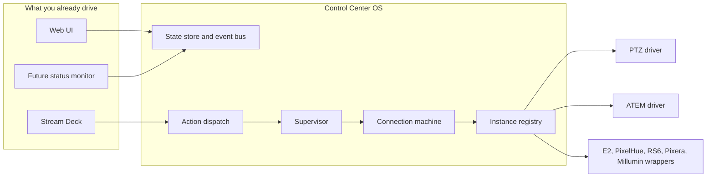

# Control Center OS

This is the core the desk sits on. The pages you already use (RS6, E2, PixelHue, ATEM, PTZ, Pixera, Millumin, scopes, TSL, Stream Deck) stay. Phase 1 puts one connection machine, one action path, and one snapshot under them. PTZ and ATEM run on that path. The other drivers are wrapped so they use the same connection machine without a rewrite.

The app still has no control-path dependencies and no build step. Node 16 or later.

## Why a small state machine, not XState

A state machine is a list of states and the only moves allowed between them. `lib/cue-machine.js` was already that, for a cue run. The connection machine, the transport machine (play / record), and the macro machine are the same kind of code: a function in, a new state or the same object out.

XState is a good library. It is also a large dependency, and this app is meant to run on a show machine, including a Pi, with `node server.js` and nothing else to install for the desk. A table you can read top to bottom is easier to trust at 2 a.m. than an actor system. If a future module needs parallel child machines, we can revisit that. We do not need it to know if a camera is up.

Plain values stay plain. Iris, gain, a Videohub crosspoint, and an ATEM program bus are numbers in the driver. They do not get a machine. Machines are for things that move through steps: the link, a cue, a macro, record / play.

## The picture



One snapshot (`GET /api/core`) and one change stream (the existing event stream, event name `core`, plus `GET /api/core?since=`) feed the browser, the deck, and a later console monitor. Scopes video stays on its own WebSocket. That socket is pictures, not the desk state.

## Connection machine

File: `lib/core/connection.js`.

| State | What you should believe |
|---|---|
| disconnected | No attempt. No address, or you held the link. |
| connecting | First handshake, or a retry that has never succeeded. |
| connected | The driver says the device is answering. |
| degraded | Up, but only partly. One of three cameras. A switcher that is slow to answer. |
| reconnecting | The link dropped. The core waits, then tries again. The wait grows: 1s, 2s, 4s… up to 30s. The poll interval is the first wait, so a test that polls fast still retries fast. |
| failed | The retry budget (8 tries) is spent. The card can show FAILED. A later tick still tries, so a device that comes back is not stuck. |

The old card words are still there, in `status.link`: `idle`, `connecting`, `reconnecting`, `ok`, `offline`. `status.fsm` is the machine. The SYSTEMS card shows FAILED and DEGRADED from `fsm`. ONLINE / CONNECTING / RECONNECTING / OFFLINE are unchanged otherwise.

Each PTZ camera has its own machine under the PTZ instance. The instance is `degraded` when at least one camera answers and at least one does not.

The original RS6 (id `rs6`) is still the Engine. Its machine is not driven. If the Engine is connected, the public `fsm` says `connected`. Every other instance, including a second RS6, uses the machine.

Holding Disconnect sends `stop` and closes the driver. The poller does not call that device until you connect again.

## Registry and module contract

`SystemManager` still owns the pool, the show file, and `/api/sys/...`. On startup it attaches every slot to the core.

A module is a manifest from `lib/core/sdk.js`: id, label, kind, actions, feedbacks, surface templates, and which fields are plain values. `defineModule()` checks the shape. Planned gear is listed so the contract is visible, and it is **not** on the SYSTEMS palette:

- Videohub (crosspoints stay plain)
- HyperDeck (record / play uses the transport machine)
- Mitti

`GET /api/core/modules` returns the list. A real driver is still one file in `lib/drivers/` plus a row in `lib/systems.js`. The manifest does not replace that yet. It is the place a new driver declares itself so the core, the deck, and the docs agree.

PTZ and ATEM actions go through `lib/core/dispatch.js`: one run, a timeout, a recorded result. A throw is that action's result. It does not kill the process. Other families still call their drivers the old way. Their **connection** still goes through the machine and the supervisor.

The supervisor (`lib/core/supervisor.js`) counts crashes (`TypeError` and the same family). A normal "nobody answered" is not a crash. Three crashes in a row close that driver and the poller connects it again. The next module is not touched.

## Actions the Stream Deck can bind

`POST /api/core/cmd/<action>` is the one command path. `GET /api/core/actions` is the list, with the current feedback values. `GET /api/core/feedbacks` is the same values for a deck that only needs lamps and captions.

| Action | What it does |
|---|---|
| `focus`, `focus.next` | Which instance the desk is driving. |
| `profile.save`, `profile.load` | Console profile (which deck regions belong to whom, and which instance a deck is focused on). Stored in `console.json` next to the show, keyed when you load a show. Not inside the `.rs6show` file, so old shows still hash the same. |
| `show.save`, `show.stage`, `show.load` | Save, pick the next library show, load it. Load takes two presses, or `{ confirm: "LOAD" }` on the second press. |
| `connection.status`, `connection.reconnect`, `connection.disconnect` | Per instance. Reconnect uses the focused instance when you do not name one. |
| `module.enable`, `module.restart` | Off closes the driver and the poller skips it. Restart closes and connects. Remembered in `console.json`. |
| `health.ack` | Clears the lamp for an alert. The machine state is still the truth. |
| `service.refresh`, `service.enable` | Speaker timer, SMB share, Companion. See below. |
| `host.shutdown`, `host.reboot`, `host.cancel` | Two presses. Safe mode blocks them. The Pi does not actually power off unless `CC_HOST_POWER=1`. |
| `panel.lock`, `panel.unlock`, `panel.safe`, `panel.pin` | Lock freezes the Stream Deck except unlock, health ack, and status reads. The web UI still runs the show. Safe mode blocks power, show load, and turning a module off. |

The USB deck home page has a **CONSOLE** key in the first empty cell. That face posts these actions. The page library also has `console` and `console-power`, so a Path C push can include them. Feedback ids (`focus.name`, `health.alert`, `service.speakerTimer`, …) are stamped onto the USB captions.

### Services

Phase 1 reports status. It does not ship a speaker timer or an SMB server.

| Service | Up when | Otherwise |
|---|---|---|
| Speaker timer | `CC_SPEAKER_TIMER_URL` returns HTTP 200. JSON is kept as `output` (text, remaining). | `unconfigured` if the URL is not set. |
| SMB | `CC_SMB_PATH` exists on disk. | `unconfigured` if the path is not set. |
| Companion | A Companion connection posted feedback in the last 30 seconds, or `CC_COMPANION_URL` answers. | `unconfigured` until you add a connection or a URL. |

`service.enable` remembers on or off. With `CC_SERVICE_CONTROL=1` it also calls `systemctl start|stop` on `control-center-speaker-timer.service`, `smbd.service`, and `companion.service` (override the unit names with `CC_SPEAKER_TIMER_UNIT`, `CC_SMB_UNIT`, `CC_COMPANION_UNIT`). Leave that unset on a laptop.

### Power

First press arms the key for 8 seconds and does nothing to the machine. Second press, or `{ confirm: "SHUTDOWN" }` / `{ confirm: "REBOOT" }`, runs it. Safe mode and a locked panel refuse. Without `CC_HOST_POWER=1` the second press returns an error and does not spawn `systemctl`. That is on purpose.

### Health, logs, Pi service

- `GET /api/health` is 200 while the process is serving. 503 only if the core tick has not run for 20 seconds. Devices being down does not fail this check. systemd should restart a dead process, not a camera that is off.
- The structured ring is `GET /api/core/transitions`. Set `CC_LOG_JSON=1` to also print one JSON line per core event. The old text log is unchanged.
- `tools/systemd/control-center.service` is `Type=simple` and listens on port **8088**. Node cannot open systemd's notify socket, so `Type=notify` never received `READY=1` and the start timed out. The process still calls `systemd-notify` when `NOTIFY_SOCKET` is set. A drop-in can turn on `Type=notify`, `NotifyAccess=all`, and `WatchdogSec=30`. See the README, "Install / update on the Pi".

## Companion, next to the native deck

You already export Companion pages (`lib/companion/`, SYSTEMS → STREAM DECK PAGES). That stays.

Phase 1 adds ownership and feedback:

- A **whole deck** can be `owner: "companion"`. Control Center closes the USB device so Companion can open it. The native painter does not draw that deck.
- A **region** (a row range, a column range, or a list of keys) can be Companion while the rest of that deck stays native. Those keys are labeled COMPANION and do not fire native actions. Control Center still holds USB, because two programs cannot draw one Stream Deck.
- `POST /api/core/companion/connections` adds gear this app does not drive (a Videohub module in Companion, for example): module id, label, host, port.
- `POST /api/core/companion/feedback` stores variables and button text on that connection. It shows up in `GET /api/core` under `companion`, and the Companion service lamp follows it.

```http
POST /api/core/surfaces/bind
{ "surfaceId": "deck-path-or-id", "owner": "companion" }

POST /api/core/surfaces/bind
{ "surfaceId": "deck-path-or-id", "region": { "row": [2, 3] }, "owner": "companion" }

POST /api/core/companion/feedback
{ "id": "c....", "variables": { "dest1": "Cam 3" }, "buttons": [{ "row": 0, "col": 0, "text": "Cam 3" }] }
```

Phase 2 is a satellite: Companion sends pictures for the reserved keys, and presses on those keys are forwarded to Companion, while Control Center keeps the USB device. Until then, a deck that is entirely Companion's should be marked whole-deck so we let go of USB.

## What moved in this phase

| Piece | Now |
|---|---|
| PTZ | Connection machine per system and per camera. Commands go through dispatch (timeout, recorded result). |
| ATEM | Connection machine, including Constellation because it is an ATEM. Commands go through dispatch. Macro run / wait / continue / stop updates the macro machine. Bus selects and faders stay plain. |
| E2, PixelHue, extra RS6, Pixera, Millumin | Same connection machine and supervisor. Actions are still the old driver calls. Pixera transport updates the transport machine after a successful play / pause / stop. |
| Cue run | Unchanged. `lib/cue-machine.js`. The core re-exports it. |
| Original RS6 | Unchanged Engine. `/api/settings` still connects it. |

`/api/sys/...`, `/api/deck/ptz`, and the show file are the same shapes. New fields on status (`fsm`, `attempt`, `nextAttemptAt`, `backoffMs`, `fsmReason`) are additions.

## Phase 2

Landed on top of v0.24.0:

1. E2, PixelHue, an extra RS6, Pixera, and Millumin actions go through the same dispatch path as PTZ and ATEM. Recall, take, cut, cues, and the media-server commands are included. The original RS6 Engine is still its own path.
2. Videohub (TCP 9990, crosspoints stay plain values), HyperDeck (TCP 9993, record / play / stop use the transport machine), and Mitti (OSC port 51000) are real drivers. They show on the SYSTEMS palette. Each has a simulator.
3. A console profile with bindings, a custom name, or a focus map is saved inside the show file. An older show has no `console` field, so its hash does not change, and opening it leaves the profile already on this machine. The next save copies that profile into the show.
4. Companion satellite: `POST /api/core/companion/satellite` sets the URL that receives presses on reserved keys. `POST /api/core/companion/satellite/keys` sets the label on those keys. A whole deck that is Companion's is still released so Companion can open USB.

Still later: a real speaker-timer process and SMB unit behind the status lamps, and the original RS6 Engine on the connection machine after a check on a live Aquilon.
