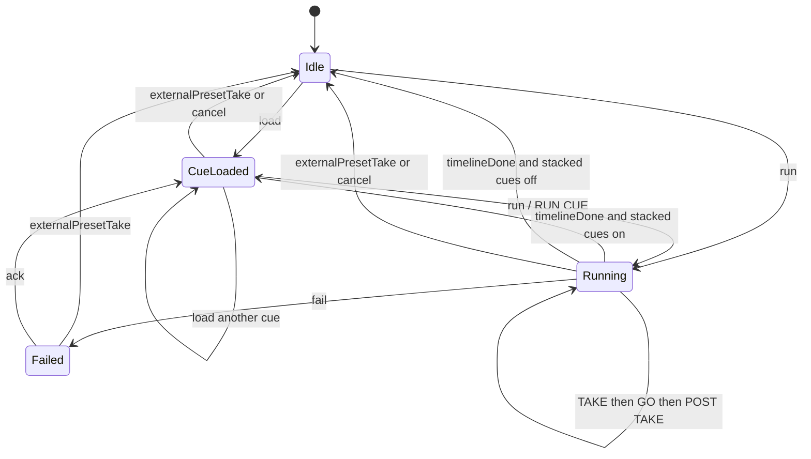

# Cues

The CUES tab is the show cue stack. A cue runs only the presets on its own timeline. RUN CUE plays the loaded cue. While that timeline is running the button is locked, and another press does nothing.

The run is a small state machine in `lib/cue-machine.js`. It does not use a library. Timers live in `lib/master-cues.js` and obey the machine: a stale timer sees a new generation and does not fire.

## Layout

Edit mode, left to right, then the timeline across the bottom:

- **Systems.** A tree of each system and the presets it already stores (RS6, E2, PixelHue, ATEM macros, PTZ, saved looks). Drag a preset onto a cue button or onto the timeline.
- **Cue grid.** C1, C2, and the rest of the stack. A cue with presets on its timeline can be loaded. An empty cue is grey. Right-click a cue to edit, rename, clear, or delete it.
- **Cue stack.** The order, the stacked-cues switch, the selected cue's name and GO point, and RUN CUE.
- **Timeline.** The dotted GO line splits TAKE (fired when the cue runs) from POST TAKE (fired after GO). Drop a preset to place it. Drag an action to move it.

## States

| State | What the operator sees |
|---|---|
| idle | Nothing loaded. RUN CUE does nothing. |
| loaded | A cue is loaded. RUN CUE is live. |
| running | TAKE, then the GO mark, then POST TAKE. RUN CUE is locked. |
| failed | An action failed. The error stays up. ACK returns to loaded. |

A second `run` while the state is `running` is ignored. The machine object is not copied and the generation does not change, so no timer is armed and no action is repeated.

`externalPresetTake` is a TAKE or CUT on another tab (RS6, E2, PixelHue, ATEM cut / auto). The transition still happens. The cue is stopped and unloaded, including a cue that was only loaded, and any master-cue bail is dropped so it cannot fire on that take.

Stacked cues is a stack switch, stored in `master-cues.json`. When it is on, a finished timeline loads the next cue that has presets and unlocks RUN CUE. Empty cues are skipped. When it is off, the machine returns to idle and no cue is loaded.

ACK after a failure loads the same cue again so it can be run. It does not advance the stack.

## Stream Deck and Companion

The cue keys still POST `/api/master-cues/mcN/go`. That is RUN CUE for that cue, with the same lock: if a timeline is already running, the press is ignored. When the desk is asked for pages, each key's value is the cue state: `IDLE`, `LOADED`, `RUNNING`, or `FAILED`.

## Saved cues

Old `master-cues.json` files still load. An action that only has `offsetMs` and no section becomes a TAKE action at that time. The GO point is placed half a second after the last of those actions (or at 5 seconds when the cue is empty), so the old list still fires when you run the cue. `stacked` defaults to off. New saves add `atMs`, `section` (`take` or `post`), `goMs`, and `stacked`.

The hi-res stack on the PRESETS tab (`cues.json`) is unchanged in shape. Its GO uses the same machine for the lock. A GO while one is already running is ignored. Starting a GO clears a bail left by the previous cue, and a cancelled GO does not arm one. A bail armed by a GO that finished still waits for the next TAKE.

## Code

- `lib/cue-machine.js` — states and events, no timers
- `lib/master-cues.js` — the CUES tab stack, timeline, and timers
- `lib/cues.js` — the PRESETS-tab hi-res stack
- `public/cues-tab.js` — the tab
